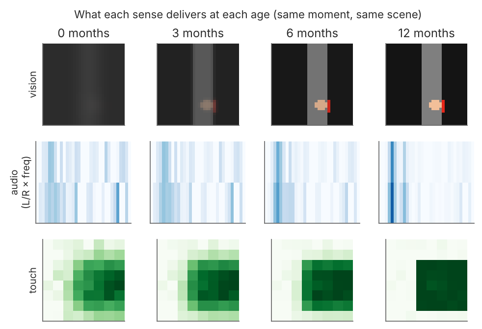

# Developmental World Models — one per sense, grown across ages

Neural "world models" of infant perception in which **every sense has its own world
model** (vision, audition, touch, proprioception), each sense **matures on its own
timetable**, each model **grows in place** from a newborn-sized network to a 12-month
one, and a **fusion world model** combines them.

Code, data pipeline, trained checkpoints, paper source and project site for
**"Do AI Models Learn Like Humans?"** (Somesh Mohapatra, Independent).

- Site and wiki: <https://pikulsomesh.github.io/developmental-world-models/>
- Paper: [`report/report.pdf`](report/report.pdf) (source: [`report/REPORT.md`](report/REPORT.md)); arXiv-format LaTeX in [`arxiv/`](arxiv/)
- Research plan: [`docs/PLAN.md`](docs/PLAN.md)
- Citation audit: [`report/REFERENCES_VERIFIED.md`](report/REFERENCES_VERIFIED.md)
- Checkpoints: [`models/`](models/)

All models are small, controlled synthetic-scene models (32x32 frames, a few hundred thousand parameters, 3-5 seeds per regime); see the Limitations in the paper for what that does and does not support.



## What is here

| Path | What it is |
|---|---|
| [`docs/PLAN.md`](docs/PLAN.md) | The research plan: what changes from the source proposal and why, per-sense specs, growth and fusion design, hypotheses, roadmap, paper plan |
| [`report/REPORT.md`](report/REPORT.md) | **Paper** with figures (PDF: `report/report.pdf`; arXiv-format LaTeX: `arxiv/main.tex`) |
| [`docs/RESULTS.md`](docs/RESULTS.md) | Headline numbers |
| `dwm/capability.py` | Per-sense developmental tables (acuity, contrast, colour, auditory resolution, tactile acuity, proprioceptive noise) and the capacity schedule |
| `dwm/env.py` | A synthetic multisensory "nursery": a toy that is seen, heard and felt, the infant's babbling hand, occluders, violation-of-expectation episodes |
| `dwm/senses.py` | Age-dependent sensory front ends (non-learned filters) |
| `dwm/models.py` | `SenseWorldModel` (encoder → windowed dynamics → decoder) with **function-preserving growth**; `FusionWorldModel` |
| `dwm/train.py`, `dwm/fusion.py`, `scripts/analyze_fusion_voe.py` | Training, linear probes, VoE surprise, fusion experiments |
| `scripts/run_experiments.py` | Runs every sense × condition × age stage, then fusion |
| `scripts/make_figures.py` | Merges results and draws the figures |
| `models/` | Trained checkpoints (curriculum_only, adult_scratch, grown; seed 0) |
| `arxiv/` | arXiv-format source (Research Future template), figures, verified bibliography |
| `docs/` | Project site and wiki (GitHub Pages) |
| `tests/` | Unit test that growth leaves the model's function unchanged |

## Quick start (CPU only)

```bash
pip install -r requirements.txt
python -m pytest -q                                   # growth is function-preserving
python scripts/run_experiments.py --quick --out /tmp/q # ~2 min smoke test
# full grid of regimes and seeds:
scripts/queue.sh
python scripts/analyze_fusion_voe.py --seeds 0,1,2
python scripts/make_figures.py && report/build.sh
```

## The idea in one picture

```
age ─► sensory front end F_s(age) ─► encoder ─► z_t ─► dynamics over last k(age) latents + action ─► ẑ_{t+1}
            (blur, contrast,            ▲                      ▲
             colour, freq. res., …)     └── width w(age) ──────┘   grows 0→3→6→12 months, function-preserving

per-sense latents z^vision, z^audio, z^touch, z^proprio ─► fusion world model (modality dropout, cross-modal fill-in)
```

## Status

Synthetic scene, four senses, six training regimes, fusion world model, own-age and adult-input probes, information ceilings, violation-of-expectation events and statistics are all included. Planned next: staged-onset fusion, realistic optics, MIMo embodiment, SAYCam/BabyView. See the roadmap in the plan.

## License

MIT (code). The plan and paper text are © the authors until the preprint is posted.
