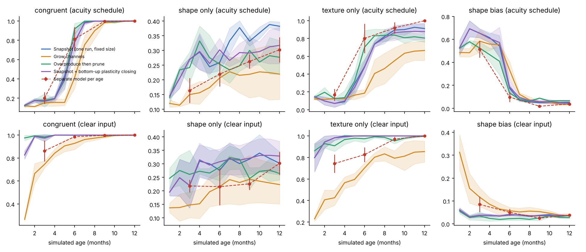
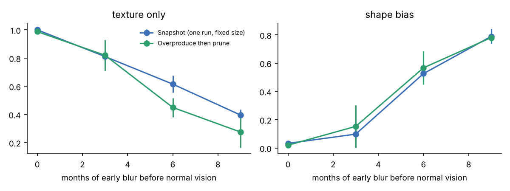
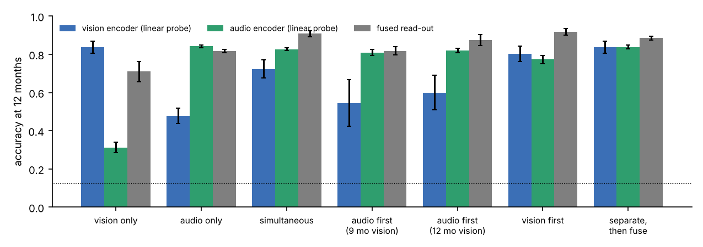

# Modelling age in developmental world models: one growing brain, not a ladder of small ones

*Somesh · Developmental World Models project · working report, 14 Oct 2026*
*Thread: "Modeling age: checkpoints vs growing models". Code, raw results and figures live next to this file in `code/`, `results/` and `figures/`.*

Companion to [paper-framing.md](../paper-framing.md), which sets the paper's overall claim. This report answers one design question in depth, how a model's "age" should be built, and tests the options with small CPU experiments.

---

## Abstract

The v1 proposal builds each age as a separate network whose size grows from about 100K to 100M parameters, and adds cognitive modules at fixed ages. Developmental neuroscience does not support this picture. Cortex has essentially all its neurons at birth; what changes after birth is the sensory periphery, the number of synapses (which rises and then falls), myelination, and the opening and closing of plasticity windows. These change on different clocks for different senses. We compare five ways to model age in small CNNs trained on a procedural vision task with the v1 proposal's acuity and contrast schedule, plus a two-sense (vision and hearing) version. Three results stand out. (1) The **immature-input schedule, not the capacity schedule, produces the infant-like trajectory**: near-chance performance for the first months, a coarse-shape phase, then a jump to fine detail at about 6 months when acuity allows it. (2) **Early experience leaves lasting traces** that only a continuous run can express: early blur leaves the 12-month model more shape-sensitive and more blur-robust than the same network trained on clear input, and a longer early "cataract" leaves a permanent fine-detail deficit even after eight months of normal vision. The same 3 months of blur hurt only when they come first, which is the signature of a critical period. A separate model per age shows none of this. (3) **The order in which senses come online matters**: in joint training, the sense that starts first crowds out the later one, and training each sense on its own before fusing gives the best per-sense models. We recommend modelling age as checkpoints of one continuous run per sense, with per-sense schedules for input maturity, synapse density and plasticity, and keeping separate per-age models only as a control.

---

## 1. The question

Somesh's question was whether to stop training mid-epoch for different ages or to train minimal models with fewer parameters, depending on how brain development works. The two options embody different theories of what "being younger" means:

- **Checkpoints of one run** say a younger infant is the same brain with less experience.
- **Smaller separate models** say a younger infant is a smaller brain.

The neuroscience below says neither is the whole story, and points to a third design: one brain, continuously trained, whose input, connectivity and plasticity mature on measured schedules.

---

## 2. What changes in the brain from 0 to 24 months

| Quantity | What happens | Differs by sense? | Sources |
|---|---|---|---|
| **Neurons** | Cortical neurogenesis is essentially complete before birth; some programmed cell death near birth. Postnatal neurogenesis is confined to hippocampus and olfactory bulb. | Not meaningfully | Rakic 1995; Stiles & Jernigan 2010 |
| **Brain volume** | About doubles in year one, then about +15% in year two, driven by dendrites, synapses, glia and myelin. | Primary sensory and motor cortex grow fastest early | Knickmeyer et al. 2008; Gilmore et al. 2018 |
| **Synapses** | Overproduced to roughly 150–200% of adult density, then pruned by experience over years. Connection count goes **up, then down**. | **Yes.** Auditory cortex peaks about 3 months, visual cortex about 8 months, prefrontal after 15 months | Huttenlocher & de Courten 1987; Huttenlocher & Dabholkar 1997; Petanjek et al. 2011 |
| **Myelination** | Posterior to anterior, sensory and motor before association. Faster conduction shortens response latencies over the first months. | **Yes** | Flechsig 1920; Deoni et al. 2011; Sydnor et al. 2021 |
| **Critical periods** | Opened by maturing parvalbumin inhibitory circuits, closed by molecular brakes (perineuronal nets, myelin-related signals). Lower levels close before higher levels. | **Yes.** Acuity and binocularity early; phoneme narrowing about 6–12 months; face narrowing about 6–9 months | Hensch 2005; Werker & Hensch 2015; Maurer & Lewis 2012 |
| **Sensory periphery** | Acuity about 1 cycle/degree at birth, rising steeply over the first year (adult values come later than v1's 12 months). Contrast and colour mature over months. In the womb, sound is low-pass filtered: prosody passes, most phonetic detail does not. | **Yes** | Banks & Bennett 1988; Teller acuity cards; Gerhardt & Abrams 2000 |
| **Sense onset order** | Touch → vestibular → chemical → hearing (about 25 weeks gestation) → vision (birth). Conserved across birds and mammals. | It *is* the per-sense difference | Gottlieb 1971; Turkewitz & Kenny 1982 |

Two frameworks help connect this to modelling:

- **Johnson's three views of functional brain development (2001, 2011).** The *maturational* view says an ability switches on when its brain region matures; the v1 design (object permanence module at 4 months, agent module at 6, goal module at 9) is maturational. *Interactive specialisation* says regions start broad and specialise through experience and competition; most of the evidence favours this for cortex.
- **Experience-expectant vs experience-dependent learning (Greenough, Black & Wallace 1987).** Some circuits overproduce connections and keep the ones that species-typical input uses (binocular vision is the classic case). Overproduce-then-prune is the direct computational analogue.

---

## 3. The options and what ML already knows

| Option | Closest ML evidence | Biological fit |
|---|---|---|
| **A. Checkpoints of one run** | Stage-like transitions within one run (Saxe, McClelland & Ganguli 2019); word age of acquisition read from LM checkpoints (Chang & Bergen 2022); GPT-2 checkpoints pass through child-like stages (Evanson, Lakretz & King 2023); networks learn coarse structure first (spectral bias, Rahaman et al. 2019) | High for "age = experience" |
| **B. Separate smaller model per age** (v1 §5.1) | Scaling laws tie optimal size to data (Hoffmann et al. 2022), but this is an engineering result | Low: assumes neuron count grows; no continuity |
| **C. Grow units over time** | Net2Net (Chen et al. 2016); progressive GANs (Karras et al. 2018); GradMax (Evci et al. 2022) | Partial: resembles dendritic and synaptic growth, not neuron addition |
| **D. Overproduce, then prune** | Magnitude pruning (Han et al. 2015; Zhu & Gupta 2017); lottery tickets (Frankle & Carbin 2019); RigL (Evci et al. 2020) | High: synaptic overproduction and pruning |
| **E. Immature-input schedule** | Blur-to-sharp training (Vogelsang et al. 2018; Jang & Tong 2021, 2024); infant-ordered video curricula (Sheybani et al. 2023); acuity, contrast and colour "visual diets" (Cai et al. 2026, CVPR) | High: peripheral limits are well measured |
| **F. Bottom-up plasticity closing** | Critical periods in deep networks (Achille, Rovere & Soatto 2019; Kleinman, Achille & Soatto 2023, 2024); loss of plasticity (Ash & Adams 2020; Dohare et al. 2024) | High: staggered critical periods |
| **G. Modules switched on at set ages** (v1 §5.2.3) | none needed | Low, and circular as a test |

These lead to testable predictions. If age is mainly capacity (B, C), then models limited in size should show infant-like trajectories and history should not matter. If age is mainly experience plus maturation (A with D–F), then the trajectory should come from the input schedule, and early experience should leave lasting effects.

---

## 4. Methods (toy setting)

**Stimuli.** 32×32 grayscale images. The label is one of 8 shapes (a coarse, low-spatial-frequency cue) filled with one of 8 high-frequency gratings (a fine cue); in training both cues match the label. Test sets isolate each cue (*shape only*: flat fill; *texture only*: texture without a shape), put them in conflict (*shape bias* = share of shape-consistent answers, as in Geirhos et al. 2019), and test robustness to blur (σ = 1.5 px). Every input passes through sensor noise.

**Developmental input schedule.** The v1 acuity and contrast tables (§4.3.1) are applied as Gaussian blur and contrast loss that relax with simulated age (blur σ = 4.5 px at birth, under 0.3 px by 6 months). "Clear" runs see adult-quality input throughout.

**Age strategies (E1).** All networks are 3-layer CNNs trained with Adam on a stream of fresh samples, 100 steps per simulated month for 12 months, three seeds.
- *Snapshot*: one fixed-size network (16/32/32 channels), read out every month.
- *Grow*: same network with channels switched on at 3, 6 and 9 months (4 → 8 → 12 → 16), new channels added without changing the network's output.
- *Overproduce then prune*: a 1.5× wider network, magnitude-pruned from month 8 to 12 down to 45% of its connections, so it ends with the same number of live connections as the snapshot model (`figures/e1_capacity.png`).
- *Bottom-up plasticity closing*: snapshot network whose first-layer learning rate falls 20× between months 3 and 6 and second-layer rate between 6 and 9.
- *Separate per age*: independent networks for 3, 6, 9 and 12 months, sized like the grow model at that age, each trained from scratch for that many months on input fixed at that age's quality (the v1 design).

**Early deprivation (E2).** A "cataract": heavy blur (σ = 3 px) for the first 0, 3, 6 or 9 months, followed by exactly 8 months of clear input for everyone, so recovery time is equal.

**Sensory onset order (E3).** Each sample pairs an image with a synthetic 32×32 spectrogram of the same class (formant patterns with pitch, timing and heavy noise, calibrated so each sense alone reaches about 80%). Two sense-specific encoders feed a shared linear read-out. Schedules: *simultaneous*; *audio first* (3 "prenatal" months of womb-filtered audio, then both senses, vision maturing from birth); *vision first* (audio starts at 3 months); *separate then fuse* (each sense trained alone for 12 months, then frozen and fused with a linear read-out). A matched control gives the audio-first model the full 12 postnatal months of vision (15 months total). Encoder quality is measured with a linear probe on each frozen encoder.

---

## 5. Results

### 5.1 The input schedule, not capacity, produces the infant-like curve



*Figure 1. Accuracy and shape bias across simulated age for each strategy. Top row: with the v1 acuity and contrast schedule; bottom row: clear input. Shaded bands and error bars are ±1 s.d. over 3 seeds. Red points are separate per-age models.*

With the developmental schedule (top row), **every** strategy shows the same broad shape: near chance until about 4 months, a phase where the few correct answers rely on coarse shape (shape bias 0.5–0.7 at 1–5 months), and then a jump at 5–7 months when acuity becomes good enough to resolve the gratings, after which the networks switch to the fine texture cue (shape bias below 0.1). With clear input (bottom row), the fixed-size networks are essentially adult by month 2, which no infant is. The age at which fine detail becomes usable is set by the input schedule, as it is in infants.

Capacity changes the speed, not the shape. The **grow** model is slowest in every condition and never fully learns the texture cue (texture-only 0.66 ± 0.11 at 12 months with the schedule, against 0.91 ± 0.06 for the snapshot). With clear input, the small early grow model does show a brief early shape bias (0.31 at month 1), so a capacity bottleneck can also produce coarse-first behaviour. This confound is why capacity must be a controlled factor and not the definition of age.

### 5.2 Early experience leaves lasting traces that only a continuous run can show

| 12-month model (mean ± s.d., 7 seeds) | Shape-only accuracy | Blur robustness |
|---|---|---|
| Snapshot, developmental input | **0.34 ± 0.05** | **0.25 ± 0.10** |
| Snapshot, clear input (identical to the separate 12-month model) | 0.30 ± 0.04 | 0.16 ± 0.05 |
| Paired difference (same seed) | +0.04, higher in 6 of 7 seeds (t = 2.1) | +0.10, higher in 6 of 7 seeds (t = 2.1) |

At 12 months the input is adult-like, so a separate 12-month model trained only on 12-month input is identical to the clear-input model; it has no history. The snapshot model that went through the blurry months ends up more shape-sensitive and more blur-robust, the direction reported for blur-to-sharp training (Vogelsang et al. 2018; Jang & Tong 2024). The effect is small but consistent: with seven seeds it holds in six of seven paired comparisons for both measures.



*Figure 2. Early "cataract": heavy blur for the first k months, then 8 months of clear input for every model. Left: fine-detail (texture-only) accuracy. Right: shape bias.*

| Months of early blur | Fine detail, snapshot | Fine detail, prune | Shape bias, snapshot |
|---|---|---|---|
| 0 | 1.00 ± 0.00 | 0.99 ± 0.02 | 0.03 ± 0.01 |
| 3 | 0.81 ± 0.04 | 0.82 ± 0.11 | 0.10 ± 0.04 |
| 6 | 0.61 ± 0.06 | 0.45 ± 0.07 | 0.53 ± 0.06 |
| 9 | 0.40 ± 0.04 | 0.27 ± 0.11 | 0.79 ± 0.05 |

Eight months of normal vision does not undo early deprivation: fine-detail accuracy falls steadily with the length of the early blur, and the networks stay committed to the coarse cue they learned first. This is the computational counterpart of the lasting acuity deficits after congenital cataract (Maurer & Lewis 2012) and replicates the "critical learning period" of Achille et al. (2019). The overproduce-then-prune network loses more after long deprivation (0.27 vs 0.40 at 9 months). Its pruning ran at months 8–11 in all conditions, so for long deprivations it pruned connections shaped by blurred input, consistent with the idea that pruning stabilises whatever circuits early experience built. Neither effect can be studied with separate per-age models.

### 5.3 The sense that comes online first crowds out the later one



*Figure 3. Per-sense encoder quality (linear probe on the frozen encoder) and fused accuracy after 12 months, for each onset schedule. Dotted line: chance.*

| Schedule | Fused | Vision encoder | Audio encoder |
|---|---|---|---|
| Vision only | 0.71 ± 0.05 | 0.84 ± 0.03 | n/a |
| Audio only | 0.82 ± 0.01 | n/a | 0.84 ± 0.01 |
| Simultaneous | 0.91 ± 0.02 | 0.72 ± 0.05 | 0.83 ± 0.01 |
| Audio first (9 months of vision) | 0.82 ± 0.02 | 0.55 ± 0.12 | 0.81 ± 0.02 |
| Audio first, matched 12 months of vision | 0.87 ± 0.03 | 0.60 ± 0.09 | 0.82 ± 0.01 |
| Vision first | 0.92 ± 0.02 | 0.80 ± 0.04 | 0.77 ± 0.02 |
| Separate, then fuse | 0.88 ± 0.01 | **0.84 ± 0.03** | **0.84 ± 0.01** |

When the senses share one read-out, the sense that becomes useful first takes over and the later one's encoder is under-trained. In the human order (hearing first), the vision encoder ends well below a vision-only network (0.60 vs 0.84), even when it gets the same 12 months of visual input. When vision starts first, audio suffers less, because audio is learned quickly once it arrives. Training each sense separately and fusing afterwards gives the best per-sense encoders, at a small cost in fused accuracy relative to joint training (0.88 vs 0.91). This matches Kleinman et al. (2023) on multisensory critical periods, Lickliter's quail studies, in which unusually early visual stimulation before hatching altered the chicks' normal auditory responsiveness (Lickliter 1990; to verify), and Turkewitz & Kenny's (1982) argument that staggered, limited sensory input protects each sense from competition. For this project it supports the plan of **sense-specific world models first, fusion later**, and says that if senses are trained jointly, the onset schedule is a real experimental variable rather than a detail.

### 5.4 What did not show an effect in this toy

Bottom-up plasticity closing and overproduce-then-prune did not change the normal (undeprived) trajectory much. The plasticity schedule did not lock in the early shape phase, because the top layer stayed plastic and could switch to texture. These mechanisms need tasks where early-learned low-level features matter later (for example, perceptual narrowing or cross-sense binding) before their value can be judged. They should stay in the design as factors, with no promise of a benefit.

### 5.5 Sensitivity to deprivation depends on age: a critical period


*Figure 4. A 3-month blur window placed at different ages, each followed by 8 months of clear input (snapshot model, 3 seeds).*

| Blur window | Fine-detail accuracy after recovery | Shape bias |
|---|---|---|
| 0–3 months | 0.81 ± 0.04 | 0.10 ± 0.04 |
| 3–6 months | 1.00 ± 0.00 | 0.04 ± 0.01 |
| 6–9 months | 0.94 ± 0.08 | 0.05 ± 0.01 |
| 9–12 months | 0.96 ± 0.06 | 0.06 ± 0.04 |

The same three months of blur cause a lasting deficit only when they come first. Later windows are largely recovered from. This is the defining property of a critical period, sensitivity that depends on *when* experience is missing rather than how much, and it arises in a plain continuous run without any built-in plasticity schedule (as in Achille et al. 2019). A ladder of separate per-age models cannot express it, because no model carries its past forward.

---

## 6. Recommendation and a spec for the repo

**Age is a checkpoint of one continuous run per sense, placed by cumulative experience, with biology entering through schedules.** Concretely:

1. **One run per sense, one chronological pass.** Stream data in age order; no epochs. Save checkpoints at cumulative waking-hours that correspond to 0, 1, 2, 3, 4, 6, 9, 12, 18 and 24 months. "Stop mid-epoch" is the right instinct; the unit should be hours of experience, not epochs.
2. **Fixed neuron count; schedule connections instead.** Size each sense's model once. Model synaptogenesis and pruning as a connection-density schedule (rise, then magnitude pruning), with peaks timed per sense: hearing about 3 months, vision about 8 months, association or fusion layers after 15 months.
3. **Per-sense immature input.** Vision: acuity, contrast and colour schedules (revisit v1's adult-acuity-at-12-months value). Audition: womb low-pass filter before birth and broadband after, with prenatal onset about 3 months before birth. Touch and proprioception (via MIMo) online earliest.
4. **Per-layer plasticity schedule.** Learning rate or consolidation strength decays bottom-up, with sensory layers closing before higher layers, and per sense on its own clock.
5. **Staggered sense onset and late fusion.** Train sense-specific models on their own clocks first; fuse later with a learned read-out. Treat the onset order (human order vs simultaneous vs reversed) as an experimental factor.
6. **Separate per-age models as a control only.** Keep the v1 ladder as a "capacity-only" control at matched compute, so the paper can show what capacity alone does and does not explain.
7. **No age-gated modules.** Remove modules and losses that switch on at set ages; measure when abilities emerge instead.

A suggested config shape (illustrative, values need sources before use):

```yaml
age_axis: experience_hours          # checkpoints placed by cumulative waking hours
checkpoints_months: [0, 1, 2, 3, 4, 6, 9, 12, 18, 24]
senses:
  audition:
    onset_months: -3                # prenatal
    periphery: {womb_lowpass_hz: 500, until_months: 0}
    synapse_density: {peak_months: 3, peak: 1.5, final: 1.0}
    plasticity_close_months: {layer1: 6, layer2: 9, layer3: 12}
  vision:
    onset_months: 0
    periphery: {acuity_table: v1, contrast_table: v1, colour_table: v1}
    synapse_density: {peak_months: 8, peak: 1.5, final: 1.0}
    plasticity_close_months: {layer1: 4, layer2: 8, layer3: 12}
  touch:
    onset_months: -6
fusion:
  onset_months: 3
  synapse_density: {peak_months: 15, peak: 1.5, final: 1.0}
controls: [clear_input, shuffled_order, separate_per_age, reversed_onset]
```

---

## 7. Limitations

- These are toy CNNs (about 14K connections) on procedural stimuli with a supervised objective, not self-supervised world models on headcam video. They test the logic of each age-modelling choice, not effect sizes for the real models.
- Three seeds per condition (seven for the main snapshot comparison); some effects (blur robustness, audio-first vision deficit) have large spread.
- "Months" are a fixed number of optimiser steps, not calibrated to waking hours.
- Synthetic audio is a stand-in; the womb filter is a simple frequency cut-off.
- The pruning schedule ran at fixed calendar months in the deprivation experiment, so its interaction with deprivation is a timing effect we did not vary.

---

## 8. References

Achille, A., Rovere, M., & Soatto, S. (2019). Critical learning periods in deep networks. *ICLR*.
Ash, J., & Adams, R. (2020). On warm-starting neural network training. *NeurIPS*.
Banks, M. S., & Bennett, P. J. (1988). Optical and photoreceptor immaturities limit the spatial and chromatic vision of human neonates. *JOSA A*, 5(12).
Cai et al. (2026). Learning to see through a baby's eyes: early visual diets enable robust visual intelligence in humans and machines. *CVPR*. arXiv:2511.14440.
Chang, T. A., & Bergen, B. K. (2022). Word acquisition in neural language models. *TACL*, 10.
Chen, T., Goodfellow, I., & Shlens, J. (2016). Net2Net: accelerating learning via knowledge transfer. *ICLR*.
Deoni, S. C. L., et al. (2011). Mapping infant brain myelination with magnetic resonance imaging. *J. Neuroscience*, 31(2).
Dohare, S., et al. (2024). Loss of plasticity in deep continual learning. *Nature*, 632.
Elman, J. L. (1993). Learning and development in neural networks: the importance of starting small. *Cognition*, 48(1).
Evanson, L., Lakretz, Y., & King, J.-R. (2023). Language acquisition: do children and language models follow similar learning stages? *Findings of ACL*.
Evci, U., et al. (2020). Rigging the lottery: making all tickets winners. *ICML*.
Evci, U., et al. (2022). GradMax: growing neural networks using gradient information. *ICLR*.
Flechsig, P. (1920). *Anatomie des menschlichen Gehirns und Rückenmarks auf myelogenetischer Grundlage*.
Frankle, J., & Carbin, M. (2019). The lottery ticket hypothesis. *ICLR*.
Garrido, Q., et al. (2025). Intuitive physics understanding emerges from self-supervised pretraining on natural videos. arXiv:2502.11831.
Geirhos, R., et al. (2019). ImageNet-trained CNNs are biased towards texture. *ICLR*.
Gerhardt, K. J., & Abrams, R. M. (2000). Fetal exposures to sound and vibroacoustic stimulation. *J. Perinatology*, 20.
Gilmore, J. H., Knickmeyer, R. C., & Gao, W. (2018). Imaging structural and functional brain development in early childhood. *Nat. Rev. Neuroscience*, 19.
Gottlieb, G. (1971). Ontogenesis of sensory function in birds and mammals. In *The Biopsychology of Development*.
Greenough, W. T., Black, J. E., & Wallace, C. S. (1987). Experience and brain development. *Child Development*, 58(3).
Han, S., et al. (2015). Learning both weights and connections for efficient neural networks. *NeurIPS*.
Hensch, T. K. (2005). Critical period plasticity in local cortical circuits. *Nat. Rev. Neuroscience*, 6.
Hoffmann, J., et al. (2022). Training compute-optimal large language models. *NeurIPS*.
Huttenlocher, P. R., & de Courten, C. (1987). The development of synapses in striate cortex of man. *Human Neurobiology*, 6.
Huttenlocher, P. R., & Dabholkar, A. S. (1997). Regional differences in synaptogenesis in human cerebral cortex. *J. Comparative Neurology*, 387.
Jang, H., & Tong, F. (2021). Convolutional neural networks trained with a developmental sequence of blurry to clear images reveal core differences between face and object recognition. *J. Vision*, 21(12).
Jang, H., & Tong, F. (2024). Improved modeling of human vision by incorporating robustness to blur in convolutional neural networks. *Nature Communications*, 15.
Johnson, M. H. (2001). Functional brain development in humans. *Nat. Rev. Neuroscience*, 2. (And 2011, *Dev. Cognitive Neuroscience*, 1.)
Karras, T., et al. (2018). Progressive growing of GANs. *ICLR*.
Kleinman, M., Achille, A., & Soatto, S. (2023). Critical learning periods for multisensory integration in deep networks. *CVPR*.
Kleinman, M., Achille, A., & Soatto, S. (2024). Critical learning periods emerge even in deep linear networks. *ICLR*.
Knickmeyer, R. C., et al. (2008). A structural MRI study of human brain development from birth to 2 years. *J. Neuroscience*, 28(47).
Lickliter, R. (1990). Premature visual stimulation accelerates intersensory functioning in bobwhite quail neonates. *Dev. Psychobiology*, 23.
Maurer, D., & Lewis, T. L. (2012). Human visual plasticity: lessons from children treated for congenital cataracts. In *Plasticity in Sensory Systems*.
Petanjek, Z., et al. (2011). Extraordinary neoteny of synaptic spines in the human prefrontal cortex. *PNAS*, 108(32).
Rahaman, N., et al. (2019). On the spectral bias of neural networks. *ICML*.
Rakic, P. (1995). A small step for the cell, a giant leap for mankind. *Trends in Neurosciences*, 18(9).
Rohde, D. L. T., & Plaut, D. C. (1999). Language acquisition in the absence of explicit negative evidence: how important is starting small? *Cognition*, 72(1).
Saxe, A. M., McClelland, J. L., & Ganguli, S. (2019). A mathematical theory of semantic development in deep neural networks. *PNAS*, 116(23).
Sheybani, S., et al. (2023). Curriculum learning with infant egocentric videos. *NeurIPS*.
Stiles, J., & Jernigan, T. L. (2010). The basics of brain development. *Neuropsychology Review*, 20.
Sydnor, V. J., et al. (2021). Neurodevelopment of the association cortices: patterns, mechanisms, and implications for psychopathology. *Neuron*, 109(18).
Turkewitz, G., & Kenny, P. A. (1982). Limitations on input as a basis for neural organization and perceptual development. *Dev. Psychobiology*, 15(4).
Vogelsang, L., et al. (2018). Potential downside of high initial visual acuity. *PNAS*, 115(44).
Werker, J. F., & Hensch, T. K. (2015). Critical periods in speech perception: new directions. *Annual Review of Psychology*, 66.
Zhu, M., & Gupta, S. (2017). To prune, or not to prune. arXiv:1710.01878.

*Citations checked online this session: Garrido 2025, Kleinman 2023/2024, Evanson 2023, Jang & Tong 2024, Cai 2026. The rest are from memory and should be verified before submission.*
