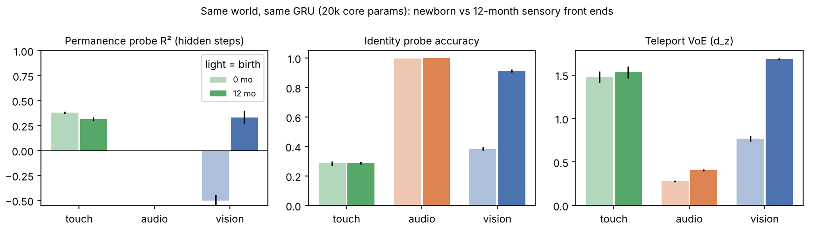
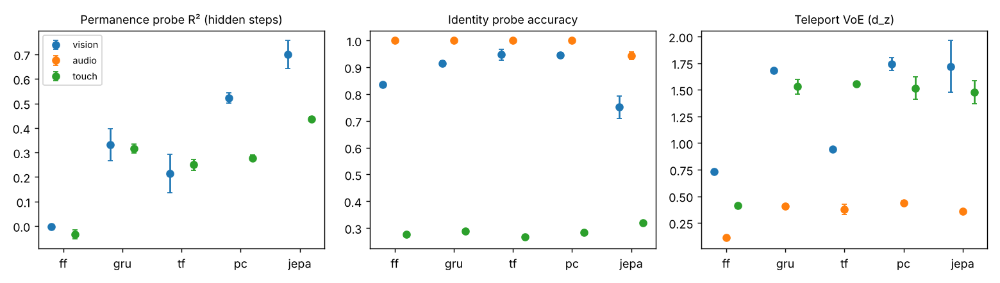
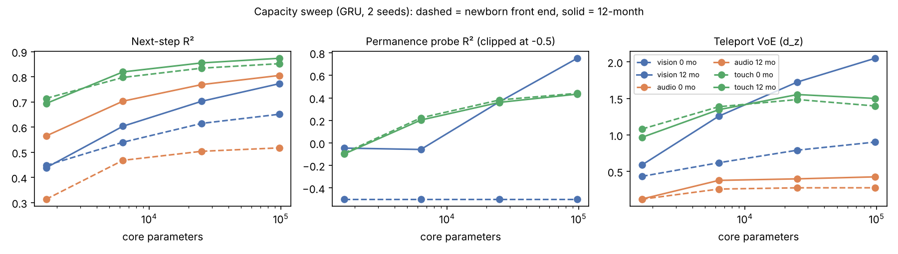
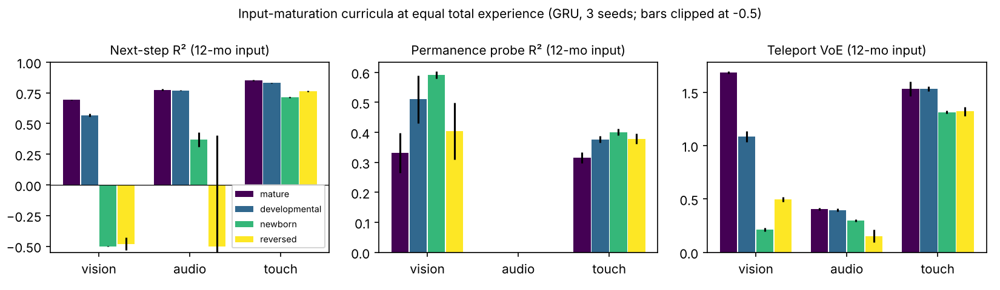
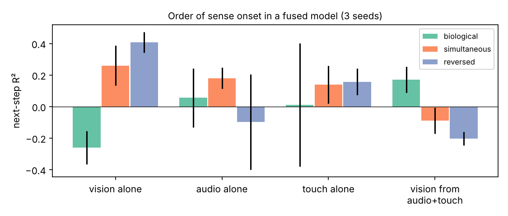
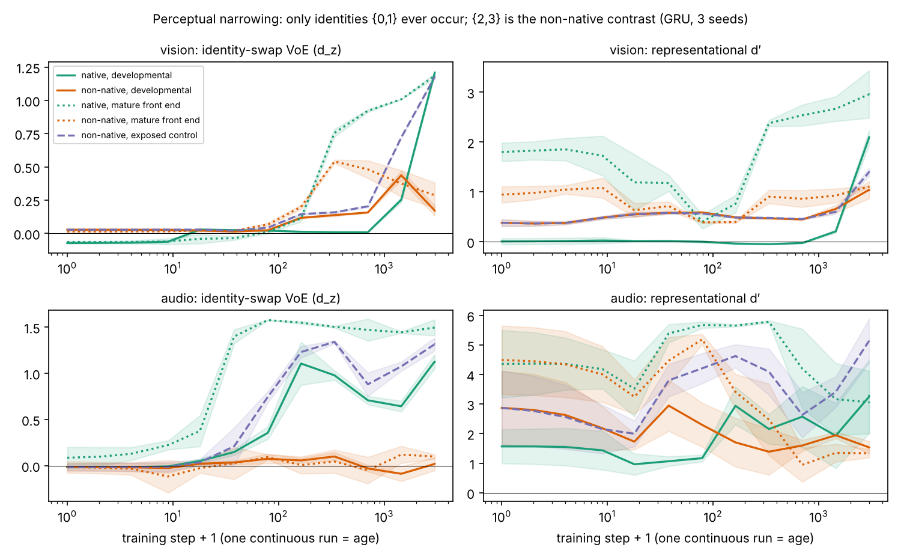

# Comparing developmental world models across senses

*Cross-sense comparison thread, 14 Oct 2026. Code and raw results: `experiments/cross_sense/` on branch `cross-sense-comparison` (also in the project folder `research/cross-sense/`). Citation keys refer to `research/refs.bib`.*

## Abstract

To compare world models across vision, hearing and touch, the comparison has to hold the task fixed and vary only the sense. We built a toy world in which one latent scene (an object of one of four identities moving and bouncing along a track) is rendered into all three senses. Every violation-of-expectation (VoE) event is applied to the latent scene before rendering. We then trained five self-supervised world-model families with matched core parameter counts (feed-forward, GRU, causal transformer, predictive-coding RNN and JEPA) under newborn and 12-month sensory front ends. Across about 240 CPU runs, six results matter for the paper. (1) Age-specific front ends alone reproduce the infant order of sensory maturity at birth: touch is close to mature, hearing partly mature, vision far behind. (2) Memory is the one sense-general requirement: the memoryless model is last on VoE in every sense, while the ranking of the other families changes from sense to sense. (3) The training objective changes which violations a model "notices": JEPA tracks occluded objects best but is nearly blind to identity changes in sound. (4) The minimal model size differs by sense, and at birth extra capacity does not rescue vision, so input limits rather than capacity set the newborn ceiling. (5) Input-maturation curricula matter mainly for the sense whose input matures most (vision), and in a fused model the human onset order (touch, then hearing, then vision) gives the worst vision-alone prediction but the best filling-in of vision from the other senses. (6) Perceptual narrowing, the non-monotonic milestone, appears in a plain predictive model: in vision, surprise at a never-seen identity contrast rises and then falls while the native contrast keeps improving, and an exposed control does not fall.

## 1. What a cross-sense comparison must control

The project's framing note (`research/paper-framing.md`) recommends a *test* framing: which developmental constraints are necessary or sufficient for infant-like trajectories. Cross-sense comparisons are where that framing is easiest to break, because three things differ between senses at once:

1. **The task.** "Object permanence" in vision and "word segmentation" in hearing are different computations, so a model that does one better than the other says nothing about the senses.
2. **The input format and size.** A 144-pixel frame and a 16-taxel arm need different input layers, so raw loss and raw parameter counts are not comparable.
3. **The experience clock.** Hearing starts around 24–26 weeks of gestation through a low-pass womb, touch earlier still, and patterned vision only at birth (gottlieb1971ontogenesis, turkewitz1982limitations). A "0-month" vision model and a "0-month" audio model have had very different amounts of experience.

### 1.1 Design principles

| Principle | How it is implemented here | Real-data version |
|---|---|---|
| **Latent-matched paradigms.** One latent world, rendered into each sense; violations applied to the latent. | `world.py`: same object, motion, "teleport" and "identity-swap" violations seen, heard and felt. | A shared-latent simulator (MIMo renders vision, touch, proprioception and vestibular input from one physical scene; mattern2023mimo, lopez2025mimo), plus audiovisual infant corpora where sound and image share events (sullivan2021saycam, long2024babyview). |
| **Each sense has its own "occluder".** | Vision: an occluder hides the object. Touch: the object is felt only within reach. Hearing: always audible, but position is coded only by loudness. | Occlusion, out-of-reach, silence. |
| **Match core parameters; report adapters separately.** | Input/output layers scale with the sense's input size (as primary sensory cortices differ in size). The core between them is matched (about 20k parameters). | Same rule at scale. |
| **Same objective family across senses.** | Next-step prediction (JEPA: next latent). | Same. |
| **Common age axis that includes prenatal months.** | Ages −3, 0, 3, 6, 12 months; per-sense front ends (`age.py`). | Postmenstrual age, with hours of usable input per sense. |

### 1.2 Shared metrics

All metrics have the same definition for every sense and model.

| Metric | Definition | Infant analogue |
|---|---|---|
| Next-step R² | 1 − prediction error / variance of the next input, scored against the noise-free (age-filtered) input | General sensitivity to regularities |
| Permanence probe | Linear-probe R² for object position, only on steps where the object is hidden *for that sense* | Object permanence (baillargeon1985object) |
| Identity probe | Linear-probe accuracy for object identity (chance 0.25) | Discrimination after habituation |
| VoE effect size | Paired Cohen's d_z of prediction error, violation vs matched control | Looking-time difference |
| Narrowing index | Representational d′ and swap-VoE for a never-experienced ("non-native") contrast across checkpoints | Perceptual narrowing (werker1984cross, pascalis2002species, lewkowicz2006decline) |

For the paper, add milestone age (the experience at which a metric first crosses criterion) and **developmental alignment**: Kendall τ between the order in which a model reaches milestones and the order in which infants do, within and across senses. That is the headline number a cross-sense paper can report honestly.

### 1.3 Benchmark battery per sense (for the real-data paper)

| Sense | Milestone (approx. age) | Paradigm to port |
|---|---|---|
| Touch / proprioception | Visual–tactile synchrony (newborn); contingency learning (mobile paradigm, ~3 mo) | Synchrony VoE; action → consequence prediction (MIMo) |
| Hearing | Rhythm-class discrimination (newborn); statistical word segmentation (~8 mo); native vs non-native narrowing (6–12 mo; werker1984cross); rhythm narrowing (hannon2005tuning) | Habituation probes, transitional-probability VoE, non-monotonic discrimination curve |
| Vision | Acuity curve (norcia1985spatial, banks1988optical); object permanence VoE (baillargeon1985object); agents and goals (gandhi2021baby); face narrowing (pascalis2002species) | Grating detection, VoE, BIB |
| Multisensory | Audiovisual matching and its narrowing (lewkowicz2006decline) | Cross-modal prediction, AV-synchrony VoE |

Neural alignment for senses other than vision should rely on infant EEG and fNIRS (auditory mismatch responses are well studied in newborns) and representational similarity rather than voxelwise encoding, because infant data are noisy and RSA applies identically to every sense.

## 2. Methods (toy setting)

- **World.** Object position x ∈ [0, 1], speed 0.03–0.06 per step, bouncing at walls; identity k ∈ {0..3}. Vision: 12×12 frames, a 3×3 shape per identity, grey occluder over x ≈ 0.6–0.8. Hearing: 24 frequency bins, harmonic tone with pitch set by identity, loudness falls with distance, broadband click at wall collisions. Touch: 16 taxels covering x < 0.5, pressure bump at the object's position, vibration rhythm set by identity. Sequences of 24 steps; violations at step 12.
- **Front ends by age** (`age.py`, coarse literature anchors): vision blur and noise from acuity and contrast sensitivity (no patterned input prenatally); hearing frequency smear, noise, and a low-pass womb filter prenatally; touch spatial smear and noise.
- **Models** (`models.py`), core ≈ 20k parameters each: `ff` (no memory), `gru`, `tf` (2-layer causal transformer, 8-step window), `pc` (recurrent core receives only the prediction error, after Rao & Ballard / PredNet), `jepa` (predicts the next latent of an EMA target encoder with a variance term against collapse).
- **Training.** Adam, 1,000 steps × 64 sequences, fresh data every step (no epochs). Three seeds per cell (two for the capacity sweep). Evaluation on 512 held-out sequences.

## 3. Results

### 3.1 Front ends alone reproduce the order of sensory maturity at birth

*Figure 1. The same GRU trained and tested with newborn (light) vs 12-month (dark) front ends. Mean ± s.d. over 3 seeds. Hearing has no hidden steps, so no permanence bar.*

| GRU, 20k core | Touch 0 → 12 mo | Hearing 0 → 12 mo | Vision 0 → 12 mo |
|---|---|---|---|
| Permanence probe R² | 0.38 → 0.32 | n/a | **−2.23 → 0.33** |
| Identity accuracy | 0.28 → 0.29 | 1.00 → 1.00 | **0.38 → 0.91** |
| Teleport VoE d_z | 1.48 → 1.53 | 0.28 → 0.41 | **0.77 → 1.68** |
| Identity-swap VoE d_z | ≈0 → ≈0 | 0.68 → 1.29 | 0.19 → 0.86 |

At birth the touch model is already at its 12-month level, the hearing model discriminates identity perfectly but is half as surprised by identity changes, and the vision model cannot track a hidden object (negative R² means worse than guessing the average position) or tell identities apart. That is the infant order (touch and hearing ahead of vision). It is **built in by the front-end tables**, not discovered, and the paper should say so: the useful conclusion is that per-sense input maturation is *sufficient* for the cross-sense ordering at birth, so no age-specific architecture is needed to get it. (Touch carries identity weakly in this toy, so its identity numbers stay near chance at both ages; that is a property of the rendering, not of development.)

### 3.2 Memory is the sense-general requirement; everything else depends on the sense

*Figure 2. Five model families at a matched core size, 12-month front ends, 3 seeds.*

| 12 mo, 20k core | ff | gru | tf | pc | jepa |
|---|---|---|---|---|---|
| Vision permanence R² | −0.00 | 0.33 | 0.21 | 0.52 | **0.70** |
| Vision teleport VoE | 0.73 | 1.68 | 0.94 | **1.74** | 1.72 |
| Hearing teleport VoE | 0.11 | 0.41 | 0.38 | **0.44** | 0.36 |
| Hearing identity-swap VoE | **1.32** | 1.29 | 0.96 | 0.81 | 0.08 |
| Touch permanence R² | −0.03 | 0.32 | 0.25 | 0.28 | **0.44** |
| Touch teleport VoE | 0.41 | 1.53 | **1.56** | 1.52 | 1.48 |

- The memoryless model ranks **last on teleport VoE in all three senses** and has no permanence anywhere. A violation of continuity can only surprise a model that carries the past forward, in every sense. This is the one architectural conclusion that transfers across senses.
- The order of the four memory-based families **changes by sense** (predictive coding first in vision and hearing, transformer first in touch). A paper that compares senses must therefore use the same family for every sense and treat the family as a reported factor, not choose the best model per sense.
- **The objective decides what a model notices.** JEPA, which never reconstructs the input, tracks hidden objects best in vision and touch (0.70 and 0.44; consistent with latent-prediction models showing intuitive-physics VoE, garrido2025intuitive) but is almost blind to an identity change in sound (d_z 0.08 vs 1.29 for the GRU), even though identity can be read from its state (0.94). A "failure" on an identity-violation test can be an objective artefact, so VoE results should always be reported for at least one reconstruction model and one latent model.
- Predictive coding (the recurrent core sees only its own prediction error) matches or beats the GRU at the same size in vision (permanence 0.52 vs 0.33). It is a cheap, brain-motivated variant worth carrying into the main repo.

### 3.3 Minimal model size differs by sense, and capacity cannot fix newborn vision

*Figure 3. GRU capacity sweep, 1.7k to 97k core parameters. Dashed: newborn front end; solid: 12-month front end. Mean of 2 seeds.*

- **Smallest core reaching the 12-month plateau:** hearing about 6k parameters (teleport VoE 0.38 of 0.43 at 97k), touch about 24k (1.55; flat after), vision still improving at 97k (permanence 0.75, VoE 2.05). A per-sense "minimal model" table is therefore meaningful, and vision needs the largest budget, roughly in line with visual cortex being the largest sensory system.
- **With newborn input, vision stays poor at every size**: permanence R² is −2.67 at 1.7k and −2.09 at 97k, against +0.75 for the 12-month front end at the same size. Touch and hearing with newborn input are nearly as good as with 12-month input at every size.

This answers Somesh's "smaller models for younger ages" question for the cross-sense case. Shrinking the model is not what makes a newborn model newborn-like; the front end already does that, and it does so differently per sense. Smaller per-age models remain useful as an ablation that asks how small a model can be and still reach a milestone, which is the proposal's first research question.

### 3.4 Input-maturation curricula matter mainly for vision

*Figure 4. Equal total experience (1,000 steps): mature front end throughout; developmental (0 → 3 → 6 → 12 months in quarters); newborn throughout; reversed (12 → 0). Tested on 12-month input. 3 seeds; bars clipped at −0.5.*

| Tested on 12-mo input | Vision permanence | Vision teleport VoE | Hearing next-step R² | Touch teleport VoE |
|---|---|---|---|---|
| Mature throughout | 0.33 ± 0.07 | **1.68 ± 0.01** | 0.77 | 1.53 |
| Developmental | **0.51 ± 0.08** | 1.09 ± 0.05 | 0.77 | 1.53 |
| Newborn throughout | 0.59 ± 0.01 | 0.21 ± 0.02 | 0.37 | 1.31 |
| Reversed | 0.40 ± 0.09 | 0.49 ± 0.02 | −1.37 | 1.32 |
| Prenatal start (−3 → 12) | n/a | n/a | 0.76 | 1.48 |

- In **vision**, a blurry-first curriculum trades sharp next-frame prediction (VoE 1.09 vs 1.68, having seen sharp input for only a quarter of training) for better tracking of hidden objects (0.51 vs 0.33). This is the direction of blur-first results in vision (vogelsang2018potential, vogelsang2024impact) and of the age-modeling thread's shape-bias and blur-robustness results.
- In **hearing and touch**, the developmental curriculum costs nothing and gains nothing (hearing R² 0.77 vs 0.77; touch VoE 1.53 vs 1.53), and a prenatal low-pass start is also free. The benefit of "starting small" scales with how much the sense's input changes with age, which is a testable cross-sense prediction for the real-data paper.
- Robustness did not carry over: models that ended on sharp input lost the ability to predict newborn-quality input (vision R² −13.9 for the developmental model on newborn input). The age-modeling thread found a small, lasting blur-robustness benefit with a classification read-out, so this depends on the objective and read-out and should be measured both ways.

### 3.5 Order of sense onset in a fused model

*Figure 5. One GRU core fed by all three senses (2,000 steps). Biological: touch from the start, hearing from 25%, vision from 50%. Reversed: vision, then hearing, then touch. 3 seeds. Each bar uses only the named input(s).*

| Fused model | Vision alone R² | Hearing alone R² | Touch alone R² | Vision predicted from hearing + touch |
|---|---|---|---|---|
| Biological order | −0.26 ± 0.11 | 0.06 ± 0.19 | 0.01 ± 0.39 | **0.17 ± 0.08** |
| Simultaneous | 0.26 ± 0.13 | 0.18 ± 0.07 | 0.14 ± 0.12 | −0.09 ± 0.08 |
| Reversed | **0.41 ± 0.07** | −0.10 ± 0.30 | 0.16 ± 0.08 | −0.20 ± 0.04 |

The sense that arrives last is predicted worst on its own, which matches the age-modeling thread's finding that the earlier sense crowds out the later one (kleinman2023critical, turkewitz1982limitations). The new observation is the last column: only the biological order produces a shared state from which **vision can be partly predicted from hearing and touch alone**. When vision joins a state already organised by the other senses, its decoder learns to read that state, which is a form of cross-modal scaffolding. The probes of the full fused state are at ceiling (position R² 0.99 in every schedule), so this toy is too easy to separate schedules on fused accuracy; a harder fused task is needed before drawing strong conclusions. Unequal per-sense experience is inherent to onset designs and must be reported next to any onset result.

### 3.6 Perceptual narrowing appears without being built in

*Figure 6. One continuous run per model (3,000 steps; checkpoints = age). Training only ever contains identities {0, 1} ("native"); {2, 3} is the "non-native" contrast. Exposed control: same front end, all four identities in training. GRU, 3 seeds, bands ±1 s.d.*

| GRU, 3 seeds | Early (step 0) | Peak | End (step 3,000) |
|---|---|---|---|
| **Vision, mature front end:** non-native swap VoE | 0.01 | **0.54 ± 0.01** (step 337) | **0.29 ± 0.09** |
| Vision, mature front end: native swap VoE | −0.06 | | 1.18 ± 0.02 |
| Vision, developmental: non-native swap VoE | 0.03 | 0.44 ± 0.04 (step 1,448) | 0.17 ± 0.03 |
| Vision, exposed control: non-native swap VoE | 0.03 | | **1.17 ± 0.01** |
| **Audio, mature front end:** non-native d′ | 4.49 | **5.19 ± 0.17** (step 78) | **1.33 ± 0.14** |
| Audio, exposed control: non-native d′ | 2.87 | | 5.15 ± 0.69 |
| Audio, any native-only run: non-native swap VoE | ≈0 | ≈0.1 | ≈0 |

- **Vision shows the infant shape.** Surprise at a non-native identity change rises with early experience (general visual features transfer to unseen shapes) and then declines as the representation specialises on the native shapes, while the native contrast keeps improving and the exposed control rises to the native level. That is the rise-then-fall profile of face narrowing (pascalis2002species) and phoneme narrowing (werker1984cross), from nothing but next-step prediction on a restricted diet.
- **Hearing narrows in representation but not in surprise.** Non-native d′ rises and then collapses (5.19 → 1.33) with the mature front end, while the exposed control ends at 5.15. But the model is never surprised by a non-native identity change, so the "early universal discrimination" half of the infant pattern is missing at the behavioural level. Which measure is the right analogue of infant discrimination (a looking-time-like surprise, or a habituation-like separability) is a choice the paper has to make explicitly, because the two disagree.
- **Touch** encodes identity too weakly in this toy (d′ < 0.3) to test narrowing; JEPA discards identity in audio (Section 3.2) and shows no narrowing signal there.
- With the developmental front end, the native vision contrast only becomes usable once acuity matures (last quarter of training), so narrowing and sensory maturation overlap in time, as they do in infants (6–12 months). The age-modeling thread notes that plasticity closing and pruning had no effect on their tasks and need a task like this one; this is the natural testbed for them.

## 4. Recommendations for the paper and repo

1. **Use latent-matched paradigms for every cross-sense claim.** Generate each test from one latent scene and render it per sense (MIMo for touch, proprioception and vision; paired audiovisual corpora for hearing and vision).
2. **Match core parameters and objective across senses; report adapters, experience hours and onset age per sense.**
3. **Report at least one reconstruction model and one latent-prediction model.** Which violations a model notices depends on the objective (Section 3.2).
4. **Carry predictive coding into the main model zoo** as a brain-motivated family that is competitive at equal size.
5. **Let front ends, not shrinking architectures, carry age.** Use per-sense minimal-size sweeps as an ablation (Section 3.3).
6. **Make perceptual narrowing the flagship cross-sense test** (Section 3.6). It is non-monotonic, documented in hearing, vision and audiovisual matching, and already appears in this toy. Pre-register which measure (surprise vs separability) counts as discrimination.
7. **Headline metric:** developmental alignment (Kendall τ between model and infant milestone order, within and across senses).

## 5. Limitations

This is a toy: 12×12 vision, 24-bin hearing and 16-taxel touch, about 20k-parameter models, 1,000–3,000 training steps, synthetic 'identities' standing in for phonemes and faces, and two or three seeds. Front-end tables are coarse literature anchors, not calibrated psychophysics. Touch carries identity weakly in this rendering. Several results (onset order, curricula) depend on the read-out and objective, as the comparison with the age-modeling thread shows. None of this should be presented as evidence about infants. It is evidence about which comparisons are fair and which design choices change conclusions.
