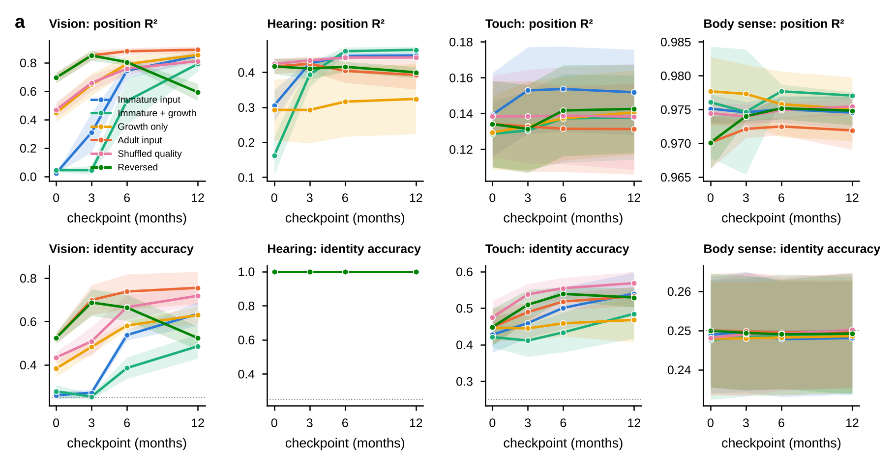

::: summary
**Infants learn from input that is degraded, ordered in time and delivered by senses that mature at different rates, whereas machine-learning systems are usually trained on clean, shuffled data. We ask how such constraints change learning in predictive world models, networks that learn by forecasting their own sensory input. We prove that, for a linear read-out under gradient flow, input contrast sets the speed of learning (scaling it by $\kappa$ delays learning by exactly $\kappa^{-2}$) while blur lowers the reachable ceiling; that widening a network delays learning; and that a squared-error forecaster is more surprised by an object's reappearance than by its disappearance. We test these results in a controlled multisensory simulation with one world model per sense and 5 seeds per training regime. A newborn-quality front end slows vision 39-fold in theory, and the trained network lags the best score its input allows (0.02 against 0.60); ablations show that contrast, not blur, produces the lag. A gentle start helps hearing and costs vision a little, growth halves compute but slows learning, and fusing senses tracks a hidden object better than any one sense. These results suggest that controlling the quality and order of input is a cheap lever for training world models when data are limited.**
:::

# Introduction

Most machine-learning systems learn from data that are clean, shuffled and presented at full quality from the first step. Biological learners do not. A human infant receives a single continuing stream of experience through sensory organs that are immature at birth and that mature on different schedules: newborn visual acuity is roughly one thirtieth of the adult's and contrast sensitivity is a small fraction of it [@banks1988optical; @norcia1985spatial], touch and hearing function earlier than vision, and the order in which senses come online may itself shape how they are combined [@turkewitz1982limitations]. Infants nevertheless learn quickly from a few thousand waking hours of such experience [@smith2018curriculum], and networks trained on one child's head-camera video now learn useful visual representations and word meanings [@orhan2020self; @orhan2024learning; @vong2024grounded]. This raises a question that is about learning rather than about infants: when the input to a learner is staged, degraded and ordered, and when its capacity may grow, what happens to the dynamics of learning, and which of these constraints help?

The evidence from machine learning is mixed. Starting with blurred or colourless images can make recognition more robust [@vogelsang2018potential; @vogelsang2024impact], slowly changing video helps self-supervised learning [@sheybani2023curriculum], and networks show critical periods of their own, including for multisensory integration [@achille2019critical; @kleinman2023critical]. Yet the benefit of "starting small" [@elman1993learning] was challenged by later simulations [@rohde1999language], ordered training helps little on standard benchmarks and mostly when training time is short or labels are noisy [@wu2021curricula], and stage-like learning can emerge from the dynamics of learning alone [@saxe2019mathematical]. What is missing is an account of *how* an input constraint changes learning, specific enough to predict which constraint will matter and by how much.

Predictive world models make this question pressing. A world model learns a compact internal model of its environment and uses it to forecast what follows from what it senses and does [@ha2018world]. LeCun argues that such models, learned by prediction in an abstract representation space rather than in pixels, are a missing ingredient of autonomous intelligence [@lecun2022path], and joint-embedding predictive architectures (JEPA) put the idea into practice for images and video [@assran2023self; @bardes2024revisiting; @garrido2025intuitive]. Li describes world models as generative, multimodal and interactive systems that predict the next state of a scene given an action, and names spatial intelligence as the next frontier [@li2025words]. These systems are trained, like language models, on very large corpora, yet training datasets are projected to grow to roughly the size of the whole stock of public human-written text between 2026 and 2032 [@villalobos2024will], and multisensory, embodied data for world models are scarcer still. How data are staged, filtered and ordered, which an infant's development does by design, may therefore matter as much as how much of it there is.

We provide an account of how input constraints change learning, for predictive world models trained to forecast their own sensory input from its recent past. We formalise a staged-input problem, prove four propositions about it (an information bound on what can be learned from filtered input, an exact learning-time law for a linear read-out, the delay that follows growth with function-preserving initialisation, and the conditional-mean account of why squared-error forecasters are not surprised by disappearance) and test each in a controlled simulation with one world model per sense. If the effects hold beyond this simulation, the quality and order of input are a cheap lever for training world models when data are limited; the Discussion says what our evidence supports and what it does not.

**Companion paper.** The same simulation and age-indexed front ends underlie a companion manuscript on sensory perception across infant ages, which collects published milestones for each sense, shows the front-end tables and the application built on them, and uses three of our modelling studies for what they say about perception [@mohapatra2026senses]. The two papers share data and say so where they do. Shared with the companion paper: the front-end parameter tables (Table 3 here; Fig. 2 there), the information-ceiling and own-age probe data for vision and hearing (Fig. 3 and Extended Data Fig. 3 here; Fig. 3 there, plotted differently), and the one-sentence finding that the ceiling-based half-age measure does not recover the infant order. New in this paper and absent there: the formal problem, the four propositions and their proofs, the spectral analysis (Fig. 2), the six training regimes with statistics and the front-end ablations, the growth analysis, the fusion model and the violation-of-expectation dissociation. The companion experiments (critical period, sense-onset order, perceptual narrowing) are reported only in the companion paper.

# Theory

**The problem.** A scene state $s_t$ evolves under the agent's action $u_t$. Each sense $s$ delivers an adult-quality observation $o_t^{s}$, a deterministic function of the scene (Methods), and a property $Y_t=g(s_t)$, such as the position or identity of a toy, is the quantity we ask a representation to retain. At age $a$ the sense delivers $\tilde o_t^{s}=\Phi_s(o_t^{s};a)$, where the front end $\Phi_s$ is a fixed, non-learned filter whose parameters (acuity, contrast, colour, frequency resolution, noise) are interpolated from published infant values for vision and from coarse tables for the other senses (Table 3, Methods). The age $a$ indexes input quality, never network structure: nothing in the networks is switched on or off by age.

Each sense has a world model, a network with an encoder $e$, a dynamics model over the last $k$ latents and the action, and a decoder $d$ (Methods). Its training objective at age $a$ is a reconstruction error plus a one-step prediction error on $\tilde o$, so the network predicts its own filtered input; a fusion model then combines the frozen latents of the four sense models. We judge a model's internal state with a probe, a linear read-out fitted to it and scored by $R^2$, the fraction of a quantity's variance the probe recovers (0 is no better than the mean, 1 is perfect); a probe measures what is stored, not what the network does with it. The information ceiling is the best score reachable from the same filtered input, estimated with a separate network trained directly on the task.

Training proceeds in four stages and the model is read out at the end of each, which we call checkpoints 0, 3, 6 and 12 months (names for training stages, not real time). Six regimes (Table 1, Fig. 1) cross the input schedule (adult quality throughout, immature input improving with age, quality drawn at random per batch, or immature input in reverse order) with capacity (fixed or grown by function-preserving widening). All regimes see the same data, the same number of updates and the same hyperparameters, so any difference is due to the schedule or to growth.

| Regime | Network | Input quality across the four stages |
|---|---|---|
| Immature input (primary) | fixed (12-month size) | 0 → 3 → 6 → 12 months |
| Immature input + growth | grows ×1 → ×4 | 0 → 3 → 6 → 12 |
| Growth only | grows ×1 → ×4 | adult throughout |
| Adult input | fixed | adult throughout |
| Shuffled input quality | fixed | each batch from a random stage |
| Reversed immaturity | fixed | 12 → 6 → 3 → 0 |

: Table 1 | Training regimes. All see the same episodes for the same number of updates.

![**Fig. 1 | Sense-specific developmental world models.** **a**, Each sense passes a synthetic nursery (a toy that is seen, heard and felt, the infant's babbling hand, and an occluding screen) through a fixed filter $\Phi_s(\cdot;a)$ indexed by age, and learns its own world model: an encoder $e$, a dynamics model $f$ over the last $k$ latents and the infant's motor command $u_t$, and a decoder. A fusion world model combines the frozen sense latents. Read-outs are linear probes, violation-of-expectation surprise and occluded tracking. **b**, The same moment delivered to vision, hearing (left ear, 32 frequency bins over the episode) and touch (an 8×8 patch of skin) at 0, 3, 6 and 12 months. **c**, Front-end maturity per sense (normalised parameters of Table 3): touch and proprioception start close to mature, hearing partly, vision far behind. **d**, The six training regimes: input quality over the four training stages; marker size is network width.](figures/fig1_overview.png){width=100%}

We state four results about this setting. Each proof is short and given in full; Fig. 2 and the Results test each result against the simulation.

**Proposition 1 (information bound).** Let $Y$ be a scene property, $O$ the adult-quality observation and $\tilde O_a=\Phi(O;a)$ the filtered observation, with $\Phi$ a stochastic degradation of $O$, so that $Y\to O\to\tilde O_a$ is a Markov chain. Then for every representation $Z=e(\tilde O_a)$,
$$I(Z;Y)\le I(\tilde O_a;Y)\le I(O;Y),$$
and the best squared-error read-out has ceiling $R^2_\star(a)=1-\mathbb E[\operatorname{Var}(Y\mid\tilde O_a)]/\operatorname{Var}(Y)$, and it does not increase from age $a$ to age $a'$ whenever $\tilde O_{a'}$ is a further degradation of $\tilde O_a$ (nested filters, so that $Y\to\tilde O_a\to\tilde O_{a'}$ is a Markov chain).

*Proof.* The inequalities are the data-processing inequality applied twice. For the ceiling, if $\tilde O_{a'}$ is a further degradation of $\tilde O_a$ then $\mathbb E[Y\mid\tilde O_{a'}]=\mathbb E\big[\mathbb E[Y\mid\tilde O_a]\mid\tilde O_{a'}\big]$, and by Jensen's inequality the variance of this conditional mean cannot exceed that of $\mathbb E[Y\mid\tilde O_a]$. Since $\operatorname{Var}(Y)=\mathbb E\operatorname{Var}(Y\mid\cdot)+\operatorname{Var}(\mathbb E[Y\mid\cdot])$, the residual variance cannot decrease. $\blacksquare$

The proposition separates what the input contains from what learning extracts. The supervised ceiling we report estimates $R^2_\star(a)$ from below; the gap between a self-supervised model and that ceiling is a property of learning.

**Proposition 2 (learning time under gradient flow).** Let $\tilde x=\Phi(o;a)-\mathbb E\,\Phi(o;a)$ be the centred filtered input, $y$ a standardised target, $\Sigma=\mathbb E\,\tilde x\tilde x^\top=\sum_i\lambda_i v_iv_i^\top$ its covariance and $c_i=v_i^\top\mathbb E[\tilde x y]$. A linear read-out $W(0)=0$ trained by gradient flow $\dot W=-\nabla_W\mathbb E\lVert y-W^\top\tilde x\rVert^2/2$ has explained variance
$$R^2(t)=\sum_{i:\lambda_i>0}\frac{c_i^2}{\lambda_i}\Big(1-e^{-2\lambda_i t}\Big),\qquad R^2(\infty)=\sum_{i:\lambda_i>0}\frac{c_i^2}{\lambda_i}.$$
Consequently: (a) if the front end scales input fluctuations by $\kappa$, then $\lambda_i\to\kappa^2\lambda_i$ and $c_i\to\kappa c_i$, so $R^2_\kappa(t)=R^2_1(\kappa^2t)$: the same ceiling is reached $\kappa^{-2}$ times later. (b) If the front end is a Gaussian blur with standard deviation $\sigma$ and the input statistics are approximately shift-invariant, the variance of a mode at angular spatial frequency $\omega$ is multiplied by $e^{-\sigma^2\omega^2}$, so its learning time is multiplied by $e^{\sigma^2\omega^2}$: coarse modes are barely affected, fine modes are learned exponentially later, and modes whose variance falls below a noise floor or the resolution of a finite training budget are not learned at all.

*Proof.* In the eigenbasis of $\Sigma$ the modes decouple: $\dot w_i=c_i-\lambda_iw_i$, so $w_i(t)=(c_i/\lambda_i)(1-e^{-\lambda_it})$. The variance explained by mode $i$ is $2w_ic_i-\lambda_iw_i^2=(c_i^2/\lambda_i)(1-e^{-2\lambda_it})$, and the modes add. For (a), scaling $\tilde x$ by $\kappa$ scales $\Sigma$ by $\kappa^2$ and the cross-covariance by $\kappa$, so $c_i^2/\lambda_i$ is unchanged and $\lambda_it$ becomes $\kappa^2\lambda_it$. For (b), the Fourier transform of a Gaussian of width $\sigma$ is $e^{-\sigma^2\omega^2/2}$, so power at frequency $\omega$ is multiplied by $e^{-\sigma^2\omega^2}$. $\blacksquare$

Two points limit how far this carries. The statement is for a linear read-out and plain gradient descent; deep linear networks show a similar inverse dependence of learning time on the strength of an input-output mode, with sigmoidal rather than exponential timing [@saxe2019mathematical], and nonlinear networks can only be expected to follow it loosely. And adaptive optimisers such as Adam divide each step by a running estimate of gradient magnitude, which weakens the dependence on the global scale $\kappa$ (for a linear read-out, from $\kappa^{-2}$ towards roughly $\kappa^{-1}$); whether contrast or blur dominates in a trained network is therefore an empirical question, which the front-end ablations below answer.

**Proposition 3 (growth delay).** Widen a hidden layer from $n$ to $n'$ units by $W_1'=\begin{bmatrix}W_1\\R\end{bmatrix}$ and $W_2'=[\,W_2\;\;0\,]$, with $R$ arbitrary. Then the network's function is unchanged, $W_2'\phi(W_1'x)=W_2\phi(W_1x)$, the gradient on the new incoming weights is zero,
$$\frac{\partial\mathcal L}{\partial R}=\big(\mathbf 0^\top\delta\big)\odot\phi'(Rx)\,x^\top=0,$$
while the gradient on the new outgoing weights $A$ (initially $0$) is $\partial\mathcal L/\partial A=\mathbb E\big[\delta\,\phi(Rx)^\top\big]$, which is nonzero only if the new units' activations are correlated with the residual error $\delta$ (for $\phi(0)=0$ this requires $R\neq0$). New capacity therefore starts to learn only through its outgoing weights: once $A\neq0$ the new units act as fixed random features, and their incoming weights $R$ adapt at a rate proportional to $\lVert A\rVert$.

*Proof.* The first claim follows because the new units' contribution is multiplied by zero. The gradient with respect to $R$ passes through the new outgoing weights $0$, which gives the displayed expression. The gradient with respect to the new outgoing weights is $\mathbb E[\delta\,\phi(Rx)^\top]$, which is nonzero unless $\phi(Rx)$ is uncorrelated with the residual. $\blacksquare$

The origin $(r,a)=(0,0)$ of an incoming and an outgoing weight is a saddle of the loss. With $\dot a=\rho r$ and $\dot r=\rho a$, where $\rho$ measures the correlation of the new unit with the residual, $a(t)=a_0\cosh\rho t+r_0\sinh\rho t$, so $a$ reaches a given size $a^\ast$ after $t\approx\rho^{-1}\log\big(2a^\ast/\lvert a_0+r_0\rvert\big)$: with $a_0=0$ the delay grows with $\log(1/\lvert r_0\rvert)$ and shrinks with the step size and with $\rho$, which itself falls as the existing units absorb the residual. Growth therefore buys a cheaper early network (fewer parameter-updates) at the price of a plateau after each widening.

**Proposition 4 (surprise of a squared-error forecaster).** The predictor $\hat o_{t+1}$ minimising $\mathbb E\lVert\hat o_{t+1}-o_{t+1}\rVert^2$ given the past is the conditional mean $\mathbb E[o_{t+1}\mid o_{\le t}]$. Consider a pixel behind a screen, which shows $o^{\text{toy}}$ if the toy reappears at the next frame, with probability $p$, and $o^{\text{screen}}$ otherwise, and let $\Delta=o^{\text{toy}}-o^{\text{screen}}\neq0$. In a violation-of-expectation test, the surprise at a possible event is compared with the surprise at an impossible one. The optimal forecast is $(1-p)\,o^{\text{screen}}+p\,o^{\text{toy}}$ and the surprise (squared error) is
$$S_{\text{reappear}}=(1-p)^2\Delta^2,\qquad S_{\text{vanish}}=p^2\Delta^2 .$$
The forecaster is more surprised by reappearance than by non-reappearance exactly when $p<\tfrac12$.

*Proof.* The conditional mean minimises mean squared error (the decomposition $\mathbb E\lVert\hat o-o\rVert^2=\mathbb E\lVert\hat o-\mathbb E[o\mid\cdot]\rVert^2+\mathbb E\operatorname{tr}\operatorname{Cov}(o\mid\cdot)$). Substituting the two outcomes gives the displayed errors, with $\Delta^2$ read as $\lVert\Delta\rVert^2$ for vector observations. $\blacksquare$

When the time of reappearance is uncertain, $p<\tfrac12$ for most frames of an occlusion, so a negative violation-of-expectation index, averaged over frames, is the correct behaviour of a well-trained pixel forecaster and is not a failure of training or of memory. (The argument is exact for the unweighted loss. The vision networks are trained with extra weight $w_r\ge1$ on moving pixels, which replaces the threshold $\tfrac12$ by $1/(1+w_r)$.) A positive index requires either a forecaster whose probability of reappearance exceeds one half, or an additional signal (such as a sound) that makes the impossible event informative.

Fig. 2 shows the spectral quantities of Proposition 2 measured on the simulation's own frames.

![**Fig. 2 | Spectral account of learning time.** For the toy-position read-out from filtered frames. **a**, Eigenvalue spectrum of the input covariance at the four ages: immature front ends shrink it by orders of magnitude. **b**, Exact gradient-flow solution $R^2(t)$ of Proposition 2 for each age with the step size fixed by the adult input; dotted lines, the linear ceilings. **c**, Time to half the ceiling when only contrast is scaled by $\kappa$: the exact solution follows $\kappa^{-2}$. **d**, Blur alone: the ceiling falls with the blur width while the time to half ceiling barely moves.](figures/fig6_theory.png){width=100%}

# Results

**A controlled simulation isolates each constraint.** The simulated world renders one toy of four types, a babbling hand and, in half the scenes, a vertical screen into four streams: 32×32 colour vision, binaural hearing (2 ears × 32 frequency bins, panned by position and passing through the screen), an 8×8 tactile patch on the hand, and four-dimensional proprioception (Fig. 1a; Methods). Each toy type is specified redundantly across senses, by shape and colour, pitch and felt shape [@bahrick2000intersensory]. Each sense is filtered by a fixed front end whose parameters follow the age $a$ (Fig. 1b, c; Table 3); for vision the parameters are published infant acuity and contrast sensitivity [@norcia1985spatial; @banks1988optical], and for hearing, touch and proprioception they are coarse placeholder tables that respect the known order of maturation. Behind each front end is a world model of the same family (Methods). Each sense is trained in one continuous run of four stages and read out at the end of each. The six regimes (Fig. 1d; Table 1) cross the two levers, input schedule and network growth, with two order controls.

**Vision develops last and learns slowly from newborn-quality input.** With immature input, the vision model cannot localise the toy at the first checkpoint (position $R^2$ 0.02 ± 0.00) and is still poor at the second (0.31 ± 0.15), then rises to 0.85 ± 0.04 (Fig. 3a). Trained on adult-quality input the same network localises the toy from the first checkpoint (0.69 ± 0.04) and ends at 0.89 ± 0.03. Hearing, touch and the body senses are close to their final level much earlier (Fig. 3c, e), so vision is the last sense to develop, which is put there by the front-end tables. Measured by the age at which each sense's information ceiling reaches half its 12-month value (touch 0, hearing 4, vision 0 months; Kendall $\tau$ = 0.00 against the order touch, hearing, vision; Fig. 3f) the infant order is not recovered, because the vision ceiling is already high at birth even though the learned model is not.

![**Fig. 3 | Development of each sense.** The ceiling and own-age data for vision and hearing are also plotted against age in the companion paper [@mohapatra2026senses]. **a**, Toy position decoded from the vision model's latent at each checkpoint (probe fitted and tested on adult-quality input), for the six regimes; dashed grey line, information ceiling (a supervised network trained directly on that age's filtered input). **b**, The same with the probe fitted and tested on the input quality of the checkpoint's own age. **c**, Hearing. **d**, Fraction of the age-matched ceiling reached by the immature-input regime (own-age probe) and by the adult-input regime, for vision (solid) and hearing (dashed). **e**, Proprioception (hand position R², squares) and touch (toy identity accuracy, triangles; chance 0.25) are close to their final level from the first checkpoint. **f**, Age at which each sense's information ceiling first reaches half its 12-month value; this measure does not recover the infant order (Kendall τ against touch < hearing < vision in the panel title), because the vision ceiling is already high at birth. Lines, mean over seeds; bands, ±1 s.d.; n = 5 seeds per regime.](figures/fig2_development.png){width=100%}

**The early failure is a property of learning, not of the input.** Proposition 1 asks whether this early failure is the input or the learner. Probing on each checkpoint's own input (Fig. 3b) gives 0.00 ± 0.01 at 0 months and 0.85 ± 0.04 at 12, so it is not a distribution shift from training on blurred and testing on sharp images. The newborn input is not empty: a supervised network trained directly on it reaches $R^2$ = 0.60 (Fig. 3a, dashed), and the exact linear solution of Proposition 2 reaches 0.79. The gap between 0.60 and 0.02 is therefore a property of learning. Proposition 2 also quantifies it: with the step size set by adult input, the newborn front end shrinks the total input variance from 32.20 to 0.12 and lengthens the time to half ceiling 39-fold (Fig. 2a, b). The vision model approaches its ceiling only as the front end sharpens (Fig. 3d).

**In the linear model, contrast sets the speed of learning and blur sets the ceiling.** Scaling contrast alone by $\kappa$ delays the linear solution by $\kappa^{-2}$ to within 1% over a 44-fold range, and leaves its ceiling unchanged (Fig. 2c). Blur alone leaves the time to half ceiling almost unchanged but lowers the ceiling from 0.95 without blur to 0.80 at the newborn width of 2.14 px (Fig. 2d). The linear read-out is not the network, and the networks are trained with Adam, which removes the global scale effect; ablations of the front end test which component matters in the trained vision model.

**In the trained network, contrast, not blur, produces the early lag.** When only blur follows age, the vision model already localises the toy at the first checkpoint (0.34 ± 0.05, against 0.69 ± 0.04 for adult input and 0.02 ± 0.00 for the full schedule), reaches 0.79 ± 0.05 at the second and ends at 0.88 ± 0.02 (Fig. 4a). When only contrast follows age, the model reproduces the full lag (0.04 ± 0.02 at the first checkpoint, 0.51 ± 0.04 at the second) and identity accuracy follows the same pattern (0.37 ± 0.03 against 0.60 ± 0.06 for blur only at the second checkpoint; Fig. 4b). Contrast therefore accounts for nearly all of the early delay, as Proposition 2 predicts, even though the networks are trained with Adam; blur alone costs little speed at this image scale. One caveat applies: colour saturation was held at the adult value in both ablations (5 seeds each, like every other regime), so its contribution is untested.

{width=70%}

**Growth delays learning and halves the parameter-updates.** Adding growth to immature input does not change the shape of the curve; it delays it (Fig. 3a). The grown vision model is still at $R^2$ 0.04 ± 0.03 at the 3-month checkpoint and ends at 0.79 ± 0.06, against 0.85 ± 0.04 for the fixed-size network; identity accuracy is 0.49 ± 0.06 against 0.64 ± 0.06 (Hedges' $g$ = −2.2, $p$ = 0.005). Growth without immature input learns quickly and ends near the adult-input model (0.86 ± 0.04). At matched updates, growing networks use 0.48 of the fixed network's parameter-updates (Fig. 5d). This is the plateau Proposition 3 predicts: new units begin learning only through their outgoing weights, so each widening is followed by a stall, and growth trades accuracy for compute.

![**Fig. 5 | Costs and benefits at the 12-month checkpoint.** **a**, Vision probe R² when tested on newborn-quality input (bars, mean; dots, seeds; whiskers, s.d.). All values are negative (worse than predicting the mean), so differences are in how badly models fail. **b**, Hearing localisation on clean input. **c**, Effect sizes (Hedges' g with approximate 95% CI) and Welch-test p values for the planned comparisons; n per group shown. **d**, Vision accuracy against training compute (parameter-updates relative to a fixed-size network).](figures/fig3_costs_benefits.png){width=100%}

**Early immaturity costs vision a little.** On clean input the adult-input vision model is best. Immature input costs 0.89 − 0.85 in $R^2$ ($g$ = −1.2, $p$ = 0.06). Tested on newborn-quality input, every model fails (Fig. 5a), with regimes that saw immature input failing less on average (−0.22 ± 0.14 against −0.40 ± 0.22 for adult input), but the difference is within seed variability ($p$ = 0.16); we do not claim a robustness benefit in vision.

**A gentle start helps hearing.** Models that heard immature sound early localise better on clean input at 12 months (0.45 ± 0.01 immature, 0.46 ± 0.01 immature with growth) than models that only heard adult-quality sound (0.39 ± 0.05 adult input, 0.32 ± 0.11 growth only; Fig. 5b; $g$ = 1.5, $p$ = 0.05). Shuffled input quality (0.44 ± 0.01) is close to the immature schedule, so the benefit comes from having heard degraded input at all, a form of augmentation (the mixture objective of training at several qualities), more than from its order. Reversing the schedule is the clearest negative control: the vision model that ends on newborn-quality input falls from 0.85 ± 0.04 to 0.59 ± 0.07, so what the model has learned does not survive a late degradation.

**Fusing senses recovers what each sense alone loses.** During a long occlusion, the hidden toy's horizontal position can be decoded from the vision model's memory ($R^2$ 0.60 ± 0.08 at 12 months), from hearing, which passes through the screen (0.42 ± 0.09), and best from the fused world model (0.75 ± 0.06; Fig. 6a; paired difference fused minus vision positive in every seed). The advantage appears at 6 months and nothing is decodable at 0 to 3 months, when neither vision nor binaural hearing can localise. For a visible toy, the fused state is better than vision alone (0.87 ± 0.03 against 0.79 ± 0.06) and, with vision switched off, still recovers position from hearing, touch and the hand (0.53 ± 0.01; Fig. 6b).

![**Fig. 6 | Fusion and expectation.** **a**, Horizontal position of a fully hidden toy decoded from the vision model's memory window, from hearing alone and from the fused world model. **b**, Position of a visible toy at 12 months from vision alone, the fused state, the fused state with vision switched off, and hearing alone. **c**, Violation-of-expectation (VoE) index of the unimodal vision models; positive means more surprise when the toy fails to reappear. **d**, VoE index of the fused model broken down by channel, for three events: the toy vanishes from every sense; it vanishes from sight and touch but keeps sounding; a silent toy vanishes. Faded bars, 0 months; solid, 12 months. **e**, Frame-by-frame surprise of one vision model (immature input, 12 months) on a possible and an impossible event; grey, toy hidden. Bands and whiskers, ±1 s.d. over seeds.](figures/fig4_fusion_expectation.png){width=100%}

**No unimodal vision model is surprised by an object's disappearance.** No unimodal vision model, in any regime, has a positive violation-of-expectation index (Fig. 6c): all are more surprised when the toy reappears than when it fails to, like a predictor that copies the last frame (Fig. 6e). This holds although the hidden toy's position is decodable from the same model's memory. It is the behaviour Proposition 4 predicts for a squared-error forecaster when the reappearance time is uncertain.

**The fused model is surprised only when a sound gives the event away.** The fused model does show a positive index when the toy vanishes from every sense (0.32 ± 0.11 at 12 months), but its channels show where the surprise comes from: hearing 0.75 ± 0.05, vision −0.04 ± 0.05 (Fig. 6d). The model notices that the sound stopped. When the toy vanishes from sight but keeps sounding, the overall index is −0.02 ± 0.01 and the vision channel −0.09 ± 0.07; when a silent toy vanishes, they are −0.04 ± 0.02 and −0.23 ± 0.11. Without a sound to give the event away, the fused model does not expect the toy back either: a read-out can show that information about a hidden object is present while the model's predictions do not use it.

# Discussion

**What the theory explains.** Table 2 sets each proposition against what we observed. The information bound and the learning-time law together account for the main shape of development in the vision model: a front end that shrinks input variance and removes fine detail makes the early read-out both lower and slower, and the self-supervised model reaches only a small fraction of the ceiling until the front end sharpens. The growth delay accounts for why growing the network did not help, and the conditional-mean result accounts for the sign of the surprise index.

| Proposition | Prediction | Observation |
|---|---|---|
| 1. Information bound | Learned score cannot exceed the ceiling at that input quality | Holds at every age; early gap is large for vision |
| 2. Learning time | Contrast scales speed by $\kappa^{-2}$; blur limits the ceiling | Exact in the linear model; in the trained network, contrast-only reproduces the lag and blur-only barely slows learning |
| 3. Growth delay | A plateau after each widening; fewer parameter-updates | Grown model lags; uses about half the parameter-updates |
| 4. Conditional mean | Negative surprise index when reappearance is uncertain | Negative for every unimodal vision model; positive only when a sound gives the event away |

: Table 2 | Predictions of the theory and what was observed.

**What it does not explain.** The linear solution is a lower bound on how deep networks behave, and the trained vision model lags its ceiling far more than the linear model lags its own, which shows that most of the delay lies in learning features, not in fitting a read-out. Proposition 2 does not apply as stated to adaptive optimisers, yet the ablations show that contrast, the component it singles out, still accounts for the early lag in the trained network. Nor does the theory explain the benefit of early immaturity in hearing: the shuffled-order control suggests augmentation, but we have not derived it.

**Implications for staged training.** Three design rules follow, each stated for the setting studied here. Reduce contrast or gain only if the cost in speed is acceptable, because it delays learning by the square of the scale with plain gradient descent and gives no lasting information benefit; use blur when the aim is to withhold fine detail early, and expect a lower ceiling in a finite budget; and do not use growth as a substitute for a schedule, because new units contribute nothing until their outgoing weights move. When surprise is the read-out, a squared-error pixel forecaster is the wrong instrument: objectives that predict in latent space [@garrido2025intuitive], represent uncertainty explicitly or are trained on longer horizons should be tested against the same dissociating events.

**Limitations.** Everything is synthetic and small (at most 0.6 million parameters per sense) and is evaluated mainly with linear probes, which measure decodability, not behaviour. The theory is exact for a linear read-out under gradient flow and is suggestive for trained networks. Hearing, touch and proprioception tables are placeholders, and the labels 0, 3, 6 and 12 months name training stages and carry no claim about hours of experience. With 5 seeds per regime, several comparisons have large effect sizes but are not significant (Fig. 5c); we report them as estimates.

**Future work.** The immediate extensions are experience-matched checkpoints of one continuous run per sense, late fusion with sense-onset order as a factor, latent-space and uncertainty-aware objectives tested against the dissociating events, and extending the spectral account to deep networks by measuring the singular-value spectrum of the learned input-output map. The data path runs from this synthetic simulation to an embodied simulator for touch and proprioception [@mattern2024mimo] and to head-camera corpora for vision and hearing [@sullivan2021saycam; @long2024babyview].

# Materials and Methods

## Experimental design

The study compares six training regimes (Table 1), plus two front-end ablations for vision, for four sense-specific world models at four checkpoints, with six analyses specified before the final runs: a spectral analysis of the filtered input (below); probes at adult-quality, own-age and newborn-quality input; a supervised information ceiling; violation-of-expectation surprise with dissociating events; occluded tracking and fill-in with a fusion model; and planned statistical comparisons (Table 4). Each regime is trained with the same data, the same number of updates and shared hyperparameters.

## Environment

Episodes last $T=20$ frames. A toy of type $c\in\{1,\dots,4\}$ moves with constant velocity and bounces in a 32×32 scene; the hand's position follows a smoothed random motor command $u_t\in\mathbb R^2$ and stays in the lower half. Half the episodes contain a vertical screen. Vision is an RGB image on a dark background; the toy is drawn with a type-specific shape and colour, the screen in grey and the hand in skin tone. Hearing is a binaural spectrum, $o^{\text{aud}}_t\in\mathbb R^{2\times32}$, a Gaussian bump at a type-specific pitch whose loudness falls with distance and whose left/right balance follows horizontal position; sound passes through the screen. Touch is an 8×8 image of the toy's shape when the hand overlaps the toy, otherwise zero. Proprioception is the hand's normalised position and velocity. Ground truth includes toy position, type, visibility and contact. Training sets have 3,000 episodes per seed, test sets 400.

**Probe events.** *Possible*: the toy crosses a central screen horizontally and reappears. *Impossible*: the toy vanishes while hidden, from every sense. *Vanish-visual*: it vanishes from vision and touch but keeps sounding as if still moving. *Silent*: possible and impossible events with no sound at all (hearing receives noise only). *Track*: like possible, with a wider screen (14 px) and varied speed, so the toy is hidden for about seven frames. Paired events share random draws so that they differ only in the manipulation.

## Front ends

All front ends are fixed functions $\tilde o=\Phi_s(o;a)$ whose parameters are linearly interpolated in age from Table 3.

*Vision.* Write $\mathrm{cpd}(a)$ for acuity (cycles per degree), $\mathrm{CS}(a)$ for contrast sensitivity and $\gamma(a)$ for colour saturation at age $a$; then
The first equation sets how much to blur the image, with more blur at lower acuity. The equations then apply that blur, pull the contrast towards the image average, and fade the colour towards grey, each by an amount that depends on age.

$$\sigma(a)=\tfrac12\cdot\frac{30}{\mathrm{cpd}(a)}\cdot\frac{32}{224},\qquad x=G_{\sigma(a)}*o,\qquad x\leftarrow \bar x+\kappa(a)\,(x-\bar x),\qquad \kappa(a)=\mathrm{clip}\!\left(\tfrac12\log_{10}\mathrm{CS}(a),\,0.15,\,1\right),$$
$$\tilde o=\mathrm{clip}_{[0,1]}\big(\ell+\gamma(a)(x-\ell)\big),\qquad \ell=0.299x_R+0.587x_G+0.114x_B,$$
where $G_\sigma$ is a separable Gaussian with replicate padding and $\bar x$ the image mean. The log compression of contrast replaces a linear gain $\mathrm{CS}/100$, which would leave a newborn 2% of contrast; contrast sensitivity is a threshold, not a gain.

*Hearing.* Per ear, $x=g_{\beta(a)}*o$ along frequency, then a high-frequency roll-off $x_f\leftarrow x_f\,\mathrm{sigmoid}\big((h(a)\cdot32-f)/1.5\big)$, then reduced interaural difference $x_{L,R}\leftarrow m+\rho(a)(x_{L,R}-m)$ with $m=\tfrac12(x_L+x_R)$, then additive Gaussian noise $\eta(a)$.

*Touch* and *proprioception.* Receptive-field blur $G_{\tau(a)}$ on the 8×8 patch plus noise; additive noise on proprioception.

| Sense | 0 months | 3 months | 6 months | 12 months |
|---|---|---|---|---|
| Vision: acuity (cpd) / contrast sensitivity / colour | 1 / 2 / 0.1 | 4 / 10 / 0.7 | 15 / 50 / 1.0 | 30 / 100 / 1.0 |
| Hearing: frequency blur (bins) / high-frequency pass / interaural difference / noise | 2.5 / 60% / 0.3 / 0.08 | 1.8 / 75% / 0.5 / 0.06 | 1.0 / 90% / 0.8 / 0.04 | 0.5 / 100% / 1.0 / 0.02 |
| Touch: receptive-field blur (taxels) / noise | 1.2 / 0.06 | 0.9 / 0.04 | 0.6 / 0.03 | 0.3 / 0.02 |
| Proprioception: noise | 0.12 | 0.08 | 0.05 | 0.02 |
| Capacity (growing regimes): width multiplier / memory window | ×1 / 1 | ×2 / 2 | ×3 / 4 | ×4 / 6 |

: Table 3 | Developmental parameters at the four checkpoints (intermediate months are interpolated). The same tables are shown graphically in the companion paper [@mohapatra2026senses].

## Spectral analysis and front-end ablations

**Spectral analysis.** For each age we generated 800 episodes without occluders, kept the 6,000 frames in which the toy is visible, applied the vision front end, centred the pixels and computed the covariance $\Sigma$ (3,072 × 3,072) and its cross-covariance with the standardised toy position. The closed-form solution of Proposition 2 gives $R^2(t)$, the linear ceiling $\sum_i c_i^2/\lambda_i$ (modes with $\lambda_i<10^{-9}\lambda_{\max}$ are dropped, which acts as a numerical noise floor) and the time to half the ceiling, found by bisection. The step size is fixed at $1/\lambda_{\max}$ of the adult input so that every age is stable under the same step. We verified the closed form against explicit gradient descent at age 0 (agreement to $10^{-3}$ in $R^2$). Controlled sweeps scale contrast or blur alone at adult quality otherwise. Code: `scripts/analyze_spectral.py`; output: `results/spectral.json`.

**Front-end ablations.** Two further vision regimes follow the immature schedule for one component of the front end only: *blur only* (acuity follows age, contrast and colour adult) and *contrast only* (contrast sensitivity follows age, acuity and colour adult). All other settings are those of the immature-input regime, with the same seeds.

## Sense world models

For sense $s$ with latent size $D_s$ (32 for vision, 16 for hearing and touch, 8 for proprioception), the encoder $e$ turns what the sense receives into a short summary $z_t$. The next summary is the current one plus a correction computed from the last $k$ summaries and the baby's own movement $u_t$, and the decoder $d$ turns a summary back into sensory input:

$$z_t=e_\theta(\tilde o_t),\qquad \hat z_{t+1}=z_t+f_\theta\big([z_t,z_{t-1},\dots,z_{t-k+1}],u_t\big),\qquad \hat o=d_\theta(z),$$

where the window is padded with the first frame. The network is penalised for failing to reproduce what it senses now and for failing to predict what it will sense next, with extra weight on pixels that change, much as babies' eyes are drawn to motion, and a small last term keeps the predicted summary close to the real next one. On a sub-sequence of 10 frames the loss is

$$\mathcal L=\frac{\sum_{t,q}m_{t,q}\,(d(z_t)_q-\tilde o_{t,q})^2}{\sum_{t,q}m_{t,q}}+\frac{\sum_{t,q}m_{t+1,q}\,(d(\hat z_{t+1})_q-\tilde o_{t+1,q})^2}{\sum_{t,q}m_{t+1,q}}+\frac{0.1}{T-1}\sum_t\lVert\hat z_{t+1}-\mathrm{sg}(z_{t+1})\rVert^2,$$

where $q$ indexes pixels or channels, $\mathrm{sg}$ is the stop-gradient and $m_{t,q}=1$ except for vision, where per-pixel weights $m_{t,q}=1+20\,\max_c|\tilde o_t-\tilde o_{t-1}|$ up-weight what moves, a stand-in for the orienting to motion without which the small toy is ignored. The vision encoder is a three-layer CNN with two coordinate channels and the decoder a spatial-broadcast decoder [@watters2019spatial]; other senses use two-layer MLPs. Widths scale with a multiplier in $\{1,2,3,4\}$.

**Growth.** Growing a network widens every hidden layer as in Proposition 3 and lengthens the window by adding input weights of zero for the new (older) memory slots, so the model's function is unchanged (checked for every layer by a numerical test). Vision models grow from 43,507 to 586,499 parameters and hearing models from 13,792 to 149,088.

**Training.** Adam, learning rate $2\times10^{-3}$, batch 32, 2,000 updates per stage for vision and 1,500 for other senses, four stages in one continuous run; weights carry over between stages and a fresh Adam optimiser is started at each stage, so all regimes see the same optimiser schedule. Hyperparameters were set once on the immature-input regime and shared by all regimes. Seeds: 5 for each regime (fusion uses the grown regime's checkpoints).

## Fusion world model

The fusion model takes frozen sense latents $z^s_t$ and a mask $\mu^s_t\in\{0,1\}$ marking which senses are present. It averages the summaries of the senses that are present, after mapping each to a common size and tagging it with its sense, and predicts forward from the last six steps:

$$h_t=\mathrm{MLP}\!\left(\frac{\sum_s \mu^s_t\,(P_s z^s_t+\epsilon_s)}{\max(1,\sum_s \mu^s_t)}\right),\qquad \hat h_{t+1}=h_t+g\big([h_t,\dots,h_{t-5}],u_t\big),$$
with projections $P_s$ to 64 dimensions and learned modality embeddings $\epsilon_s$. Read-out heads $r_s$ reconstruct every sense latent from $h_t$ and from $\hat h_{t+1}$, so the model is trained to recover each sense's own summary from the combined one, both now and one step ahead:

$$\mathcal L_{\text{fus}}=\frac1{|S|}\sum_s\Big(\lVert r_s(h_t)-z^s_t\rVert^2+\lVert r_s(\hat h_{t+1})-z^s_{t+1}\rVert^2\Big),$$
with each sense dropped independently with probability 0.3 during training. Latents are standardised per sense.

## Read-outs

**Linear probes.** A probe is a straight-line fit from the network's internal state to the quantity of interest, with a small penalty $\lambda$ against over-fitting. For features $X$ (a latent, or a memory window of latents) and targets $Y$ we use ridge regression with centred targets and an unpenalised intercept, whose closed-form solution is

$$\hat B=\arg\min_B\lVert (Y-\bar Y)-X_cB\rVert^2+\lambda\lVert B\rVert^2=(X_c^\top X_c+\lambda I)^{-1}X_c^\top(Y-\bar Y),$$
where $X_c$ are the standardised features. The probe is fitted on training episodes and evaluated on test episodes, $R^2=1-\sum\lVert y-\hat y\rVert^2/\sum\lVert y-\bar y\rVert^2$. Identity uses one-hot targets and the arg-max (chance 0.25). Touch is probed on contact frames, proprioception on hand position. *Adult-input* probes use adult-quality input; *own-age* probes use the input quality of the checkpoint's age; *newborn-input* probes are fitted on adult-quality input and tested on newborn-quality input.

**Information ceiling.** For every sense and each age $a\in\{0,1,2,3,4,6,9,12\}$ we train a separate supervised network, using the encoder design of the world models, for 1,500 updates on single filtered frames to regress the toy's position and classify its identity, and score it on held-out frames.

**Violation of expectation.** We define surprise as the squared error of the one-step forecast, $S_t=\lVert d(\hat z_t)-\tilde o_t\rVert^2$ (unimodal) or $\lVert r_s(\hat h_t)-z^s_t\rVert^2$ per channel (fused, standardised latents), averaged over the hidden stretch and the two frames after expected re-emergence. With $S_{\text{pos}}$ and $S_{\text{imp}}$ the mean surprise on paired possible and impossible events, the index VoE balances surprise at the impossible event against surprise at the possible one: it runs from $-1$, when only the possible event surprises, through 0, when both do equally, to $+1$, when only the impossible one does. The effect size $d_z$ is the average difference divided by its spread across episodes:

$$\mathrm{VoE}=\frac{S_{\text{imp}}-S_{\text{pos}}}{S_{\text{imp}}+S_{\text{pos}}},\qquad d_z=\frac{\overline{S_{\text{imp}}-S_{\text{pos}}}}{\mathrm{sd}(S_{\text{imp}}-S_{\text{pos}})}.$$

**Occluded tracking and fill-in.** The hidden toy's horizontal position is probed on fully hidden frames of the *track* events from the vision model's memory window ($k=6$ latents), from the hearing latent, and from the fused state, fitting on half of the episodes and testing on the other half. Fill-in probes toy position from the fused state with all senses, without vision, and from single senses.

**Statistics.** Bands and whiskers are ±1 s.d. over seeds. Planned comparisons at the 12-month checkpoint use Welch's t-test and Hedges' $g=\frac{\bar a-\bar b}{s_p}\big(1-\frac{3}{4(n_a+n_b)-9}\big)$ with approximate 95% interval $g\pm1.96\sqrt{\frac{n_a+n_b}{n_an_b}+\frac{g^2}{2(n_a+n_b)}}$; where $s_p$ is the pooled standard deviation of the two groups; per-cell 95% bootstrap intervals are reported with the results. No correction for multiple comparisons is applied; we list all planned comparisons.

| Comparison (12-month checkpoint) | Hedges' g | p (Welch) | n |
|---|---|---|---|
| Vision clean, immature vs adult input | −1.2 | 0.06 | 5/5 |
| Vision clean, grown vs immature | −1.0 | 0.11 | 5/5 |
| Vision identity, grown vs immature | −2.2 | 0.005 | 5/5 |
| Vision on newborn input, immature vs adult | 0.9 | 0.16 | 5/5 |
| Hearing clean, immature vs adult | 1.5 | 0.05 | 5/5 |
| Hearing clean, grown vs growth only | 1.6 | 0.05 | 5/5 |
| Hidden toy, fused vs vision memory | 1.8 | 0.01 | 5/5 |

: Table 4 | Planned comparisons.

**Compute.** Training compute is approximated by $\sum_{\text{stages}}(\text{parameters})\times(\text{updates})$; relative to a fixed 12-month-size network, grown vision models use 0.48 and grown hearing models 0.49.

**Milestones.** For each sense, the half-ceiling age is the first age at which the ceiling reaches half of its 12-month value (position R² for vision and hearing; identity accuracy above chance for touch). Kendall's τ compares the resulting order with the order of functional maturity usually described for the three senses, touch before hearing before vision [@turkewitz1982limitations].

**Human and animal studies.** The study uses only synthetic data; no human or animal participants were involved.

# Acknowledgments

During the preparation of this work, the author used an AI assistant (Claude, Anthropic) to help write and run analysis code, draw figures and draft text. The author reviewed and edited the content and takes full responsibility for the content of the publication.

# Code and data availability

All code, configurations, results and trained checkpoints are at <https://github.com/pikulsomesh/developmental-world-models> (MIT licence). The data are synthetic and are regenerated by the code from the random seeds listed in the repository. An interactive companion is at <https://pikulsomesh.github.io/developmental-world-models/>.

# Author contributions

S. Mohapatra conceived the study, directed the work and approved the final text.

# Funding

This work received no specific funding and was carried out independently.

# Competing interests

The author declares that there is no conflict of interest regarding the publication of this article.

# References

::: {#refs}
:::

# Extended Data

{width=100%}

{width=100%}

![**Extended Data Fig. 3 | Information ceilings and own-age probes.** The same ceiling data are plotted by age in Fig. 3 of the companion paper [@mohapatra2026senses]. **a**, **b**, Supervised ceilings per sense and age. **c**, Hearing probed on own-age input.](figures/ed3_ceiling_ownage.png){width=100%}
