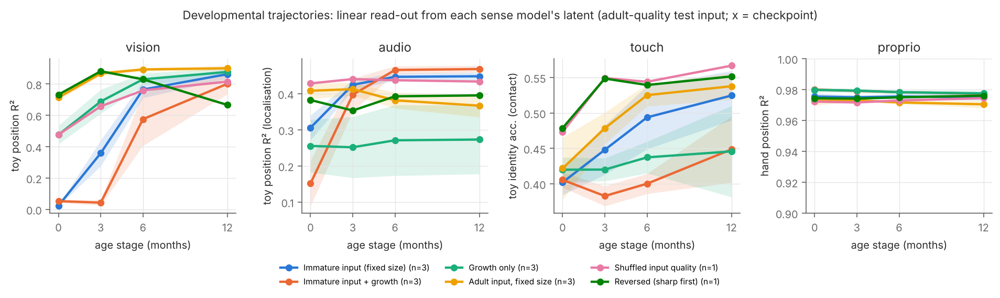
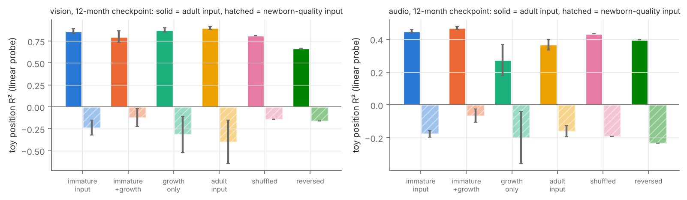
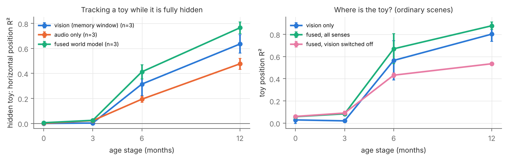
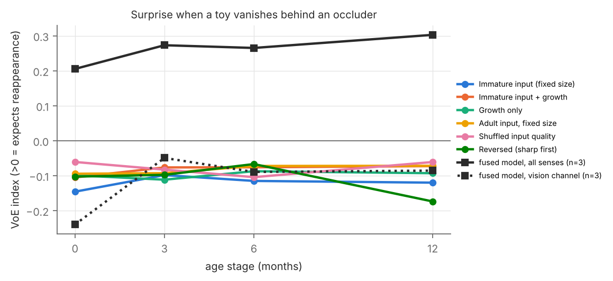
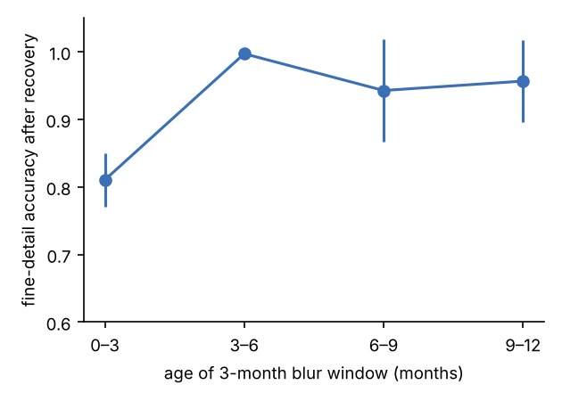
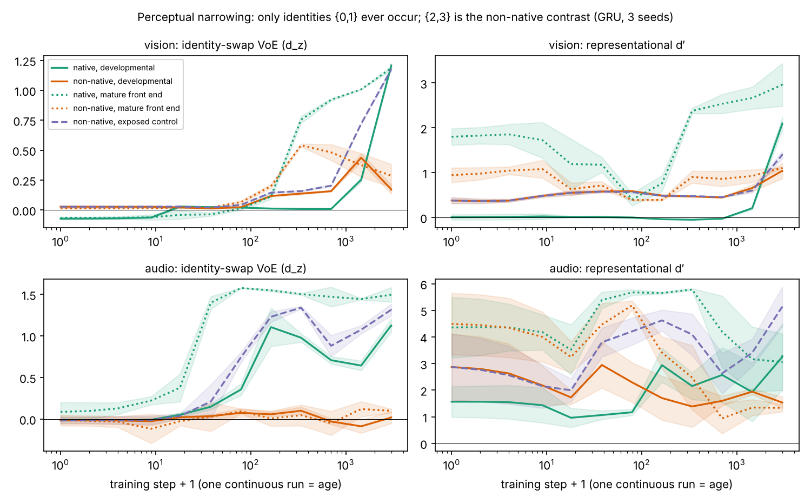

> **Status.** End-of-day report on the first day of the project. It combines the minimal models trained in the repository ([github.com/pikulsomesh/developmental-world-models](https://github.com/pikulsomesh/developmental-world-models)) with three companion analyses done the same day: the paper framing, how to model age, and how to compare senses fairly. Every experiment here is a small CPU-scale model on synthetic data. The results are evidence about **design choices**, not about infants. Citation keys are those of `refs.bib` (`[@key]` becomes `\citep{key}` in LaTeX), and all references still need checking before submission.

# Abstract

Human infants learn models of their world from a small amount of experience, received once and in order, through senses that start immature and come online at different times. We ask which of these constraints matter for self-supervised world models, and build the smallest system that can test them: **one predictive world model per sense** (vision, hearing, touch, proprioception) in a synthetic multisensory nursery, each fed through an age-indexed simulation of sensory immaturity, read out at checkpoints that stand for 0, 3, 6 and 12 months, and combined by a fusion world model. Six training regimes separate the input schedule from capacity growth and data order. Across this and two companion toy studies, four results are consistent. (1) **The input schedule, not network size, produces the infant-like trajectory.** With newborn-quality input, vision cannot localise a toy at the 0- and 3-month checkpoints (probe R² ≈ 0.0) and becomes good by 12 months (0.86), while touch and proprioception are near their mature level from the start. Growing the network on top of this only slows learning (0.80 at 12 months). (2) **Early immaturity buys robustness at a small cost.** Models raised on immature input lose less when tested on newborn-quality input than adult-input models (vision probe R² −0.24 vs −0.40, a noisy difference), and in hearing they localise better even on clean input (0.45 vs 0.37, consistent over three seeds). (3) **Combining senses helps exactly where one sense fails.** A fused model tracks a toy through a long occlusion better than the vision model's own memory or hearing alone (hidden-toy position R² 0.77 vs 0.64 and 0.48 at 12 months, three seeds). (4) **Decodable is not the same as expected.** No vision model is surprised when an occluded toy fails to reappear, even when its position is decodable; the fused model is surprised, but almost entirely through hearing (the toy stops sounding). Object permanence therefore has to be tested with paradigms, not probes. We close with the design for the full study: experience-matched checkpoints of one continuous run per sense, sensory-immaturity and plasticity schedules as the main levers, capacity growth as an ablation, late fusion, and perceptual narrowing as the flagship cross-sense test.

# 1. Introduction

By their first birthday, infants expect unsupported objects to fall and hidden objects to persist, attribute goals to agents, and have tuned their perception to the faces and speech sounds around them [@spelke2007core; @baillargeon1985object; @werker1984cross; @pascalis2002species]. They do this from a few thousand waking hours of egocentric, repetitive experience, seen once and in order [@smith2018curriculum]. Self-supervised models can now learn useful representations from a single child's headcam footage [@orhan2020self; @orhan2024learning; @vong2024grounded], and intuitive-physics expectations can emerge from video prediction alone [@garrido2025intuitive]. The sharper question is whether **the way infants receive their data matters**.

Infant learning differs from standard training in four documented ways. The senses start immature [@banks1988optical; @norcia1985spatial]. They come online in a fixed order, touch first, hearing before birth and vision at birth [@gottlieb1971ontogenesis], which may reduce competition between them [@turkewitz1982limitations]. Plasticity is staggered across senses and levels [@hensch2005critical; @werker2015critical], and synapses are overproduced and then pruned rather than neurons added [@huttenlocher1997regional]. And experience is a single non-stationary stream [@smith2018curriculum]. Training on initially blurred or achromatic input can make networks more robust [@vogelsang2018potential; @vogelsang2024impact], slowly changing early-infant video helps self-supervised learning [@sheybani2023curriculum], and deep networks have their own critical periods, including for multisensory integration [@achille2019critical; @kleinman2023critical]. But "starting small" [@elman1993learning] did not replicate elsewhere [@rohde1999language], curricula rarely help in standard regimes [@wu2021curricula], and stage-like learning can arise from learning dynamics alone [@saxe2019mathematical].

We therefore treat developmental constraints as **hypotheses to test rather than design choices to assume**. The source proposal for this project added object-permanence, agent and goal modules at 4, 6 and 9 months; anything gated that way "emerges" on schedule by construction. Here no module or loss is gated by age, and every capability has to be measured.

**Contributions of this phase.**

1. An open, CPU-scale framework with a synthetic multisensory world, age-indexed front ends for four senses, sense-specific world models with function-preserving growth, and a fusion world model (§3).
2. A six-regime comparison that separates sensory immaturity, capacity growth and data order, per sense (§4.1–4.2).
3. Evidence that fusion carries information through occlusion that no single sense keeps, and that decodability and surprise come apart (§4.3–4.4).
4. A synthesis with two companion studies on age modelling and cross-sense comparison (§4.5) and a concrete design for the full study (§6).

# 2. Related work

**Reverse-engineering infant learning.** Programmatic papers argue that infant learning should be modelled as constrained self-supervised learning and benchmarked against children [@dupoux2018cognitive; @zaadnoordijk2022lessons; @cusack2024helpless; @smith2017developmental; @frank2023bridging; @lake2017building].

**Learning from a child's perspective.** Headcam corpora [@sullivan2021saycam; @long2024babyview] support self-supervised vision [@orhan2020self; @orhan2024learning; @zhuang2022how] and grounded word learning [@vong2024grounded], also in a single chronological pass [@jiang2026babycl]; infant-view statistics make better training data than adult views [@bambach2018toddler; @sheybani2023curriculum].

**Sensory immaturity and critical periods.** Initial blur [@vogelsang2018potential] and achromatic input [@vogelsang2024impact] benefit later recognition. Critical periods arise in deep networks [@achille2019critical; @kleinman2024critical], also for multisensory integration [@kleinman2023critical], and loss of plasticity parallels their closure [@dohare2024loss].

**World models and network growth.** We use the predictive world-model formulation [@ha2018world; @hafner2023mastering] at toy scale, a spatial-broadcast decoder [@watters2019spatial], and function-preserving widening in the spirit of Net2Net [@chen2016net2net] and progressive networks [@rusu2016progressive].

**Intuitive physics, agents and brains.** Violation-of-expectation benchmarks [@riochet2021intphys; @weihs2022benchmarking; @piloto2022intuitive; @gandhi2021baby; @stojnic2023commonsense] and infant fMRI [@deen2017organization; @kosakowski2022selective; @odoherty2026infants; @odoherty2025models] are the Phase-2 and Phase-4 targets. Multisensory development is framed by intersensory redundancy [@bahrick2000intersensory]. Embodied touch and proprioception will come from MIMo [@mattern2023mimo].

# 3. Framework

{width=80%}

*Figure 1. What each sense delivers at 0, 3, 6 and 12 months, at the same moment of the same scene. The hand covers the toy in vision, while touch still feels its shape.*

## 3.1 A synthetic multisensory nursery

One toy of four types moves and bounces in a 32×32 scene; the infant's own hand babbles in the lower half (`dwm/env.py`). Each toy type is specified redundantly across senses [@bahrick2000intersensory]: a shape and colour in **vision**; a pitch in **hearing** (2 ears × 32 frequency bins, louder when near, panned by horizontal position, passing through occluders); a shape on an 8×8 **tactile** patch when the hand touches it; and **proprioception** reports the hand's position and velocity. Half the scenes contain a vertical occluder. Two probe sets are generated separately: *violation-of-expectation* episodes, in which the toy crosses a central occluder and in the impossible version vanishes while hidden (from every sense), and *long-occlusion* episodes (occluder 14 px wide, about 6.6 hidden frames), used to ask where a model thinks the hidden toy is.

## 3.2 Age-indexed sensory front ends

Each sense passes through a fixed, non-learned filter whose parameters are interpolated from per-sense tables (`dwm/capability.py`; Table 1). Vision uses the proposal's acuity and contrast tables, with two corrections: contrast sensitivity is applied as a log-compressed gain rather than a linear one (a linear gain leaves a newborn 2% of contrast), and colour starts at 0.1 rather than fully achromatic. Hearing, touch and proprioception values are coarse placeholders chosen to respect the known order of maturation (touch and proprioception near mature at birth, hearing partly, vision far behind).

| Sense | 0 months | 3 months | 6 months | 12 months |
|---|---|---|---|---|
| Vision: acuity (cpd) / contrast sensitivity / colour | 1 / 2 / 0.1 | 4 / 10 / 0.7 | 15 / 50 / 1.0 | 30 / 100 / 1.0 |
| Hearing: frequency blur (bins) / high-frequency pass / binaural difference | 2.5 / 60% / 0.3 | 1.8 / 75% / 0.5 | 1.0 / 90% / 0.8 | 0.5 / 100% / 1.0 |
| Touch: receptive-field blur (taxels) / noise | 1.2 / 0.06 | 0.9 / 0.04 | 0.6 / 0.03 | 0.3 / 0.02 |
| Proprioception: position noise | 0.12 | 0.08 | 0.05 | 0.02 |
| Capacity (growing models only): width × / memory window | ×1 / 1 | ×2 / 2 | ×3 / 4 | ×4 / 6 |

: Per-sense developmental parameters at the four checkpoints. {#tbl:params}

## 3.3 Sense-specific world models

Each sense has the same model family (`dwm/models.py`): an encoder maps an observation to a latent $z_t$ (32 dimensions for vision, 16 for hearing and touch, 8 for proprioception); a residual MLP predicts $\hat z_{t+1}$ from the last $k$ latents and the infant's motor command; a decoder maps latents back to observations. The loss is reconstruction of $o_t$, prediction of $o_{t+1}$ from $\hat z_{t+1}$, and a small latent-consistency term. The vision encoder is a 3-layer CNN with coordinate channels and the decoder is a spatial-broadcast decoder [@watters2019spatial]; vision losses up-weight pixels that change between frames, which stands in for infants' orienting to motion and without which the small toy is ignored. Other senses use 2-layer MLPs.

**Growth.** `grow(width, window)` widens every hidden layer and lengthens the memory window. New units get random incoming and zero outgoing weights; new memory slots get zero input weights. The grown model computes exactly the same function as before (unit-tested), then keeps learning. Vision grows from 44k to 586k parameters and hearing from 14k to 149k.

## 3.4 Training regimes

Every sense model is trained in one continuous run of four stages (2,000 updates per stage for vision, 1,500 for the other senses) and read out at the end of each stage; a stage is a checkpoint, not a separate model.

| Regime | Size | Input quality across the four stages | Question |
|---|---|---|---|
| **Immature input** (primary) | fixed (12-month size) | 0 → 3 → 6 → 12 months | sensory immaturity alone |
| Immature input + growth | grows ×1 → ×4 | 0 → 3 → 6 → 12 | both levers (the proposal's idea) |
| Growth only | grows | adult throughout | capacity alone |
| Adult input | fixed | adult throughout | standard ML baseline |
| Shuffled input quality | fixed | each batch drawn from a random stage | order vs variety |
| Reversed immaturity | fixed | 12 → 6 → 3 → 0 | does the direction matter? |

: Training regimes. All see the same data and the same number of updates. {#tbl:regimes}

## 3.5 Read-outs

* **Linear probes** (ridge regression) from a sense model's latent to the toy's position (R²) and identity (accuracy; chance 0.25), fitted and tested on adult-quality input; touch is probed on contact frames and proprioception on the hand's position.
* **Robustness**: the same probes fitted on adult-quality input and tested on newborn-quality input.
* **Violation of expectation (VoE)**: surprise is one-step prediction error at the moment the toy should re-emerge and the next two frames; VoE index $= (S_\text{impossible} - S_\text{possible}) / (S_\text{impossible} + S_\text{possible})$, positive when the model expects the toy back.
* **Fusion** (`dwm/fusion.py`): frozen sense latents are projected to a shared space, averaged over the senses present, mixed by an MLP into a fused state $f_t$, and a windowed dynamics model predicts $f_{t+1}$; read-out heads reconstruct every sense latent from $f_t$ and from the prediction. Each sense is dropped at random 30% of the time during training. We measure **cross-modal fill-in** (toy position from $f_t$ with vision switched off) and **occluded tracking** (the hidden toy's horizontal position, probed on fully hidden frames; probes fitted on half the episodes, tested on the other half).

Seeds: three for the four main regimes (and for fusion), one for the shuffled and reversed controls. Bands and error bars are ±1 s.d. over seeds where n > 1.

# 4. Results

## 4.1 The input schedule carries age; growth only slows learning

*Figure 2. Developmental trajectories per sense and regime. Each point is a checkpoint of one continuous run, probed on adult-quality input.*

With immature input, the vision model cannot localise the toy at the 0- and 3-month checkpoints (position R² **0.02** and **0.36**) and then rises steeply (**0.77**, **0.86 ± 0.03**; Figure 2). The same network trained on adult-quality input localises it at the first checkpoint (**0.71**) and ends highest (**0.90 ± 0.02**). Hearing, touch and proprioception show much flatter curves, because their front ends start closer to maturity: proprioception is at ceiling throughout (hand-position R² ≈ 0.97), touch identity accuracy stays low in every regime (0.40–0.55; the hand rarely covers the whole toy), and hearing localisation rises from 0.31 to 0.45 as binaural cues mature. **The infant order of maturity (body senses first, hearing next, vision last) appears, and it is put there by the front-end tables**, which is what the companion cross-sense study also found (§4.5).

Adding growth on top of immature input does not change this shape; it **delays** it. The grown vision model stays at chance through the 3-month checkpoint (0.04) and ends below the fixed-size model (**0.80 ± 0.07** vs **0.86 ± 0.03** position R², **0.50** vs **0.67** identity accuracy). Growth without immature input (growth only) learns quickly and ends near the adult-input model (0.88). This matches the age-modelling study (§4.5): capacity changes the speed, not the shape.

## 4.2 Early immaturity buys robustness, and in hearing it also helps on clean input

*Figure 3. Probes at the 12-month checkpoint on adult-quality input (solid) and newborn-quality input (hatched).*

On clean input, adult-input vision is best (Figure 3). On **newborn-quality** input, every regime that ever saw immature input degrades less on average: probe R² **−0.24 ± 0.08** (immature input), **−0.12 ± 0.10** (immature + growth), **−0.14** (shuffled) and **−0.16** (reversed), against **−0.40 ± 0.25** for adult input and **−0.31 ± 0.21** for growth only. The adult-input seeds vary a lot, and all values are negative (worse than guessing the mean), so this is "less bad" rather than robust; the direction matches blur-first training in classifiers [@vogelsang2018potential] and the age-modelling study's blur-robustness result.

Hearing goes further. Models that saw immature hearing early localise better **on clean input** at 12 months (position R² **0.45 ± 0.01** immature, **0.47 ± 0.01** immature + growth) than models that only heard adult-quality sound (**0.37 ± 0.03** adult input, **0.27 ± 0.10** growth only). Shuffled (0.43) and reversed (0.40) quality are in between, so for hearing the benefit seems to come from having seen degraded input at all, a form of augmentation, more than from its order. This is the one place in our data where a developmental constraint improves clean performance. It holds in all three seeds, but the hearing front end is a placeholder, so it is a lead to test with real audio rather than a claim.

Reversed immaturity is the clearest negative control: the vision model that ends on newborn-quality input loses what it had (0.88 at the second checkpoint, **0.67** at the last). Order matters in the obvious direction.

## 4.3 Combining senses: fusion keeps what each sense loses

*Figure 4. Left: horizontal position of a fully hidden toy, decoded from the vision model's memory window, from hearing alone, and from the fused world model. Right: toy position in ordinary scenes from vision alone, from the fused state, and from the fused state with vision switched off.*

During a long occlusion the hidden toy's horizontal position is decodable from the vision model's memory window (R² **0.64 ± 0.07** at 12 months), from hearing, which passes through the occluder (**0.48 ± 0.04**), and best from the fused world model (**0.77 ± 0.05**; Figure 4, left). The fusion advantage appears at 6 months (0.41 vs 0.31 and 0.19) and nothing is decodable at 0–3 months, when neither vision nor binaural hearing can localise. In ordinary scenes, the fused state is better than vision alone (0.88 ± 0.03 vs 0.80 ± 0.07) and, with vision switched off, still recovers position from hearing, touch and the hand (0.53; Figure 4, right). Toy identity is trivially available from pitch in hearing (accuracy 1.0 at every age), so the fused model inherits it, while vision alone reaches only 0.50–0.74 depending on regime. This supports the design that trains each sense separately and fuses later, which the age-modelling study found preserves the best per-sense encoders (§4.5).

## 4.4 Decodable is not expected: object permanence must be tested as surprise

*Figure 5. VoE index when the toy vanishes behind an occluder: unimodal vision models in every regime (coloured) and the fused world model (black), overall and through its vision channel only.*

No vision model in any regime shows a positive VoE index (all between **−0.17** and **−0.06**; Figure 5): they are *more* surprised when the toy reappears than when it fails to. They behave like a "copy the last frame" predictor, even though the toy's hidden position is decodable from the same model's memory (§4.3). The fused world model does show a positive index that grows with age (**0.21 ± 0.02** at 0 months to **0.30 ± 0.08** at 12), but decomposing its surprise by sense shows that it comes from **hearing** (audio channel 0.43 → 0.75; vision channel −0.24 → −0.09): in our impossible events the toy vanishes from every sense, so the fused model notices that the sound stopped. Its vision channel stays negative, like the unimodal models. Two conclusions follow. First, a probe can show that information about a hidden object is present while the model's predictions do not use it; infant-style paradigms are needed to claim permanence. Second, multisensory VoE needs events that dissociate the senses (for example, a toy that vanishes visually but keeps sounding, or a silent toy) before it says anything about visual permanence.

## 4.5 Companion studies

Two toy studies run in parallel used independent code and stimuli and point the same way.

**How to model age** (`research/age-modeling/`). In small CNNs on a shape-versus-texture task, the proposal's acuity schedule alone produced the infant-like curve (near chance, then a coarse-shape phase, then a jump to fine detail at about 6 months), whatever the capacity strategy; growing the network was slowest and never fully learned the fine cue (texture-only 0.66 vs 0.91). A run that went through the blurry months ended more shape-sensitive and more blur-robust than a separate 12-month model trained only on 12-month input, which has no history. Most strikingly, **the same three months of blur caused a lasting deficit only when they came first** (fine-detail accuracy after recovery 0.81 for months 0–3, against 0.94–1.00 for later windows): a critical period in a plain continuous run with no plasticity schedule [@achille2019critical]. In a two-sense version, the sense that came online first crowded out the later one under joint training (the vision encoder ended at 0.60 vs 0.84 for vision alone in the human, hearing-first order), and training each sense separately before fusing gave the best per-sense encoders at a small fused-accuracy cost (0.88 vs 0.91) [@kleinman2023critical; @turkewitz1982limitations].

{width=60%}

*Figure 6. Age-modelling study: a 3-month blur window placed at different ages, each followed by 8 months of clear input.*

**How to compare senses fairly** (`research/cross-sense/`). With one latent world rendered into vision, hearing and touch, and violations applied to the latent, five world-model families at matched core size gave: front ends alone reproduce the order of maturity at birth (vision hidden-object R² −2.23 at birth vs 0.33 at 12 months; touch 0.38 vs 0.32); **memory is the only requirement shared by all senses** (the memoryless model was last on VoE in every sense), while the ranking of other families changes by sense; the objective decides what a model notices (a JEPA-style latent predictor tracked hidden objects best in vision but was nearly blind to identity changes in sound); extra capacity did not rescue newborn vision; and, importantly, **perceptual narrowing emerged without being built in**: trained only on two "native" identities, vision surprise at a never-seen contrast rose to 0.54 and then fell to 0.29 while the native contrast reached 1.18, and hearing narrowed in its representation (d′ 5.19 → 1.33) without showing surprise.

{width=80%}

*Figure 7. Cross-sense study: perceptual narrowing in one continuous run per model; "non-native" identities are never seen in training.*

# 5. Discussion

**What carries age.** Three independent toy settings agree that the infant-like shape of development comes from the **input schedule**, and that growing the network mostly slows learning. This is consistent with neurobiology, where neurons are not added after birth but the periphery, synapse density, myelination and plasticity change on per-sense clocks [@huttenlocher1997regional; @sydnor2021neurodevelopment; @hensch2005critical]. Capacity should be a controlled factor and not the definition of age; separate per-age models cannot express the history effects (critical periods, robustness from early blur) that a continuous run shows.

**What the constraints buy.** The costs and benefits are specific. Immature early vision costs a little on clean input and buys some robustness; immature early hearing improved clean localisation here. Neither is a free lunch, which is the honest version of "starting small" [@elman1993learning; @rohde1999language] and the reason the full study must report both sides.

**Why sense-specific models, then fusion.** Senses mature on different clocks, differ in what their front ends can deliver, and compete when trained jointly. Training each sense on its own schedule and fusing later keeps each encoder at its best and still gives the fused model information no single sense has (tracking through occlusion). The cross-sense study adds that the fusion and sense models should share one family with memory.

**Limitations.** Everything is synthetic, small (at most 0.6M parameters), and evaluated with linear probes and one VoE paradigm. The newborn vision filter is harsh at 32×32 (the toy is barely visible), and hearing, touch and proprioception tables are placeholders. "Months" are stages of 1,500–2,000 updates, not experience hours. Seeds are few (three for the main regimes, one for the order controls), and the robustness ordering in vision is within seed noise. The VoE result for fusion is driven by hearing because our impossible events remove the toy from every sense.

# 6. Toward the full study and the arXiv paper

Combining today's results with the framing note (`research/paper-framing.md`):

1. **Age = experience.** One continuous run per sense, one chronological pass, checkpoints at cumulative waking hours for 0, 1, 2, 3, 4, 6, 9, 12 (18, 24) months.
2. **Main levers**: per-sense sensory immaturity (real visual-angle optics, a womb low-pass filter for prenatal hearing) and a bottom-up plasticity schedule. **Factors**: capacity (fixed, grown, overproduce-then-prune), data order (chronological, shuffled, reversed), sense onset order.
3. **One model family with memory for every sense**; report one reconstruction-based and one latent-prediction (JEPA-style) model.
4. **Late fusion** after sense-specific training, with onset order as a factor.
5. **Evaluation = the capability matrix as tests**: VoE, habituation and preferential looking, with dissociating multisensory events; metrics for order (Kendall τ against infant milestones), timing and shape; **perceptual narrowing as the flagship cross-sense test**; age-matched neural alignment later [@odoherty2026infants].
6. **Data path**: synthetic (done) → MIMo for touch and proprioception [@mattern2023mimo] → SAYCam/BabyView for vision and hearing [@sullivan2021saycam; @long2024babyview].
7. **Paper**: framed as a test of which constraints are necessary or sufficient for which signatures, with pre-registered predictions. Suggested title: *Growing Up Sensory: Testing Which Developmental Constraints Make Self-Supervised World Models Infant-Like*. Primary category cs.LG, cross-listed to q-bio.NC.

**Reproducibility.** `scripts/queue.sh` runs the full grid; `scripts/make_figures.py` and `scripts/analyze_fusion_voe.py` regenerate every figure from `results/`. Companion code is in the project folder (`research/age-modeling/code`, `research/cross-sense/xsense`).

# References
