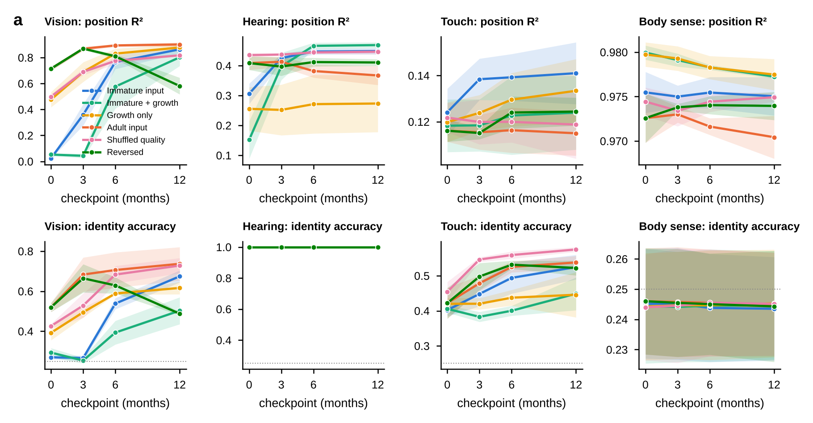
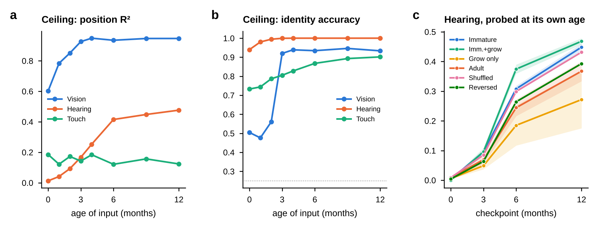

::: summary
**Babies do not learn from a perfect view of the world. Their eyes, ears and skin start out immature and sharpen on different schedules, and their experience arrives once, in order. Does this gentle start help learning, and do artificial networks learn like babies when given the same start? We built a controlled test. In a simulated nursery, a small neural network for each sense (vision, hearing, touch and body position) learns to predict what happens next, while its input is degraded to newborn quality and sharpened in steps to the quality of a one-year-old. A further network combines the senses. We compared six ways of training and measured what each network had learned at stages standing for 0, 3, 6 and 12 months. Four findings stand out. First, the input schedule alone reproduces the order in which babies' senses mature, but the networks learn much more slowly than the blurry input would allow: at the newborn stage a vision network locates a toy with a score of {{m("curriculum_only","vision","probe_adult","pos_r2",0,False)}} out of 1, whereas a network trained directly to do so scores {{ce("vision","pos_r2",0)}} on the same input. Second, making the network itself grow over time halves the training effort but slows learning. Third, a gentle start helps hearing (score {{m("curriculum_only","audio","probe_adult","pos_r2")}} versus {{m("adult_scratch","audio","probe_adult","pos_r2")}}) and costs vision a little. Fourth, combining senses finds a fully hidden toy better than any single sense ({{f("occluded_tracking","fused","x_r2")}} versus {{f("occluded_tracking","vision_memory","x_r2")}} for vision alone), yet no network expects a hidden toy to still exist: apparent surprise at its disappearance vanishes once the sound that gives it away is removed. In these simulated models, a baby-like input produces baby-like sensory development, but not a baby-like understanding that hidden objects persist.**
:::

# Introduction

Babies learn a great deal from limited experience, and they learn it through senses that are still developing. We ask whether that unusual way of receiving experience matters for learning, using small neural networks in a simulated nursery where every condition can be controlled and measured.

By their first birthday, babies expect hidden objects to still exist and unsupported objects to fall, they work out that other people act on goals, and their perception has tuned itself to the faces and speech sounds around them [@spelke2007core; @baillargeon1985object; @werker1984cross; @pascalis2002species]. They get there from a few thousand waking hours of repetitive, first-person experience that arrives once and in order [@smith2018curriculum]. Artificial networks trained on one child's head-camera footage now learn useful visual concepts and word meanings [@orhan2020self; @orhan2024learning; @vong2024grounded], and some expectations about everyday physics can emerge from learning to predict video [@garrido2025intuitive]. So the question is no longer whether machines can learn from a baby's data, but whether **the way babies receive their data** matters for what is learned.

That way differs from ordinary machine learning in four documented respects. First, the senses start out immature. A newborn sees roughly one stripe pair per degree of view, compared with about thirty for an adult, and sees faint contrasts poorly [@banks1988optical; @norcia1985spatial]. Second, the senses come online in a fixed order (touch first, hearing before birth, vision at birth), and this staggering may reduce competition between them [@turkewitz1982limitations]. Third, the brain's ability to change is itself staged across senses and across levels of processing [@hensch2005critical; @werker2015critical], and the cortex first overproduces connections and then prunes them, rather than adding new cells [@huttenlocher1997regional]. Fourth, experience is a single, changing stream rather than a shuffled data set [@smith2018curriculum]. Machine-learning studies hint that these features can help: blurred or colourless input early on can make recognition more robust [@vogelsang2018potential; @vogelsang2024impact], slowly changing baby video helps networks learn [@sheybani2023curriculum], and networks show critical periods of their own, including for combining senses [@achille2019critical; @kleinman2023critical]. But the evidence is mixed. The idea of "starting small" [@elman1993learning] was challenged by later simulations [@rohde1999language]; ordered training helps little on standard benchmarks, mostly when training time is short or labels are noisy [@wu2021curricula]; and stage-like learning can arise from the dynamics of learning alone [@saxe2019mathematical].

We therefore treat these features as hypotheses to test, not design choices to assume. Nothing in our networks switches on at a particular month; every ability is measured rather than built in. We ask four questions, each answered in one section of the Results:

1. Do the senses mature in the baby's order, and is that because of learning or because of the input?
2. Does starting with immature input help?
3. Do combined senses keep information that each sense alone loses?
4. Can a network that stores where a hidden object is also expect it to still exist?

::: terms
**Terms used in this paper.** *World model*: a network that learns to predict what happens next from what it has sensed. *Front end*: a fixed filter that makes the input as blurry or noisy as a baby's sense would be at a given age. *Checkpoint*: the state of a network after each of four training stages, labelled 0, 3, 6 and 12 months (these are training stages, not real time). *Probe*: a simple read-out that tests whether a network's internal state contains a fact, such as where the toy is; it measures what is stored, not what the network does with it. *Score (R²)*: how well a probe recovers a quantity, from 0 (no better than guessing the average) to 1 (perfect). *Information ceiling*: the best score any method could reach from the same filtered input, found by training a network directly on the task. *Violation of expectation*: a test borrowed from infant research in which surprise is compared between an event that is possible and one that is not. *Fusion model*: a network that combines the other networks' internal states.
:::

# Results

## A simulated nursery with one network per sense

We built a small simulated world in which a toy can be seen, heard and felt, and gave each sense its own prediction network whose input starts blurry and sharpens with age.

![**Fig. 1 | Sense-specific developmental world models.** **a**, Each sense passes a synthetic nursery (a toy that is seen, heard and felt, the infant's babbling hand, and an occluding screen) through a fixed, age-indexed front end $\Phi_s(\cdot;a)$, and learns its own world model: an encoder $e$, a dynamics model $f$ over the last $k$ latents and the infant's motor command $u_t$, and a decoder. A fusion world model combines the frozen sense latents. Read-outs are linear probes, violation-of-expectation surprise and occluded tracking. **b**, The same moment delivered to vision, hearing (left ear, 32 frequency bins over the episode) and touch (an 8×8 patch of skin) at 0, 3, 6 and 12 months. **c**, Front-end maturity per sense (normalised parameters of Table 1): touch and proprioception start close to mature, hearing partly, vision far behind. **d**, The six training regimes: input quality over the four training stages; marker size is network width.](figures/fig1_overview.png){width=100%}

The nursery (Fig. 1a; Methods) renders one toy of four types, a babbling hand and, in half the scenes, a vertical screen into four streams: 32×32 colour vision, binaural hearing (2 ears × 32 frequency bins, panned by position and passing through the screen), an 8×8 tactile patch on the hand, and four-dimensional proprioception. Each toy type is specified redundantly across senses, by shape and colour, pitch, and felt shape [@bahrick2000intersensory].

Each sense is filtered by a fixed front end whose parameters follow the age $a$ (Fig. 1b, c; Table 1). For vision we use published infant acuity and contrast sensitivity [@norcia1985spatial; @banks1988optical]; for hearing, touch and proprioception we use coarse placeholder tables that respect the known order of maturation. Behind each front end is a world model of the same family (Methods): an encoder, a residual dynamics model over a memory window, and a decoder, trained to reconstruct the current observation and predict the next one. Each sense is trained in one continuous run of four stages and read out at the end of each stage; we call these checkpoints 0, 3, 6 and 12 months. Six regimes (Fig. 1d; Table 2) cross two levers, the input schedule and network growth, with two order controls. All regimes see the same data for the same number of updates.

## The input sets the order of development, but learning lags behind it

Blurry input makes vision develop late and hearing and touch early, as in babies, but the vision network turns out to learn far less from its blurry input than that input contains.

![**Fig. 2 | Development of each sense.** **a**, Toy position decoded from the vision model's latent at each checkpoint (probe fitted and tested on adult-quality input), for the six regimes; dashed grey line, information ceiling (a supervised network trained directly on that age's filtered input). **b**, The same with the probe fitted and tested on the input quality of the checkpoint's own age. **c**, Hearing. **d**, Fraction of the age-matched ceiling reached by the immature-input regime (own-age probe) and by the adult-input regime, for vision (solid) and hearing (dashed). **e**, Proprioception (hand position R², squares) and touch (toy identity accuracy, triangles; chance 0.25) are close to their final level from the first checkpoint. **f**, Age at which each sense's ceiling first reaches half its 12-month value; the order matches infants, by construction of the front-end tables. Lines, mean over seeds; bands, ±1 s.d.; n = {{n("curriculum_only")}} seeds per regime.](figures/fig2_development.png){width=100%}

With immature input, the vision model cannot localise the toy at the first two checkpoints (position R² {{m("curriculum_only","vision","probe_adult","pos_r2",0)}} and {{m("curriculum_only","vision","probe_adult","pos_r2",1)}}) and then rises steeply to {{m("curriculum_only","vision","probe_adult","pos_r2",3)}} (Fig. 2a). The same network trained on adult-quality input localises the toy from the first checkpoint ({{m("adult_scratch","vision","probe_adult","pos_r2",0)}}) and ends at {{m("adult_scratch","vision","probe_adult","pos_r2",3)}}. Hearing rises modestly as binaural cues mature, and proprioception and touch are near their final level throughout (Fig. 2c, e). The infant order of maturation, body senses first, hearing next, vision last, therefore appears; half-ceiling ages are touch {{ms("half_ceiling_age_months","touch")}}, hearing {{ms("half_ceiling_age_months","audio")}} and vision {{ms("half_ceiling_age_months","vision")}} months (Kendall τ = {{ms("kendall_tau_b_approx")}} against the infant order; Fig. 2f). This agreement is put there by the front-end tables and is not a finding about learning.

Two controls separate learning from input. First, probing on adult-quality input asks a model trained on blurred images to generalise to sharp ones. Probing instead on each checkpoint's own input (Fig. 2b) gives {{oa("curriculum_only","vision",0)}} at 0 months and {{oa("curriculum_only","vision",12)}} at 12, so the early failure is not a distribution-shift artefact. Second, the newborn input is not empty: a supervised network trained directly on it decodes toy position with R² = {{ce("vision","pos_r2",0)}}, rising to {{ce("vision","pos_r2",12)}} at 12 months (Fig. 2a, dashed). The self-supervised vision model reaches only a small fraction of what its input allows at the early checkpoints and closes the gap later (Fig. 2d). The infant-like curve is thus a joint product of what the input contains and how slowly a predictive objective extracts a small object from a blurred, low-contrast scene.

## Growing the network slows learning and halves the effort

Starting with a small network that expands over time did not help; it delayed learning, for a reason we can state exactly (Box 1).

Adding growth to immature input does not change the shape of the curve; it delays it (Fig. 2a). The grown vision model is still at R² {{m("grown","vision","probe_adult","pos_r2",1)}} at the 3-month checkpoint and ends at {{m("grown","vision","probe_adult","pos_r2",3)}}, against {{m("curriculum_only","vision","probe_adult","pos_r2",3)}} for the fixed-size network; identity accuracy is {{m("grown","vision","probe_adult","type_acc",3)}} against {{m("curriculum_only","vision","probe_adult","type_acc",3)}} (Hedges' g = {{st("vision identity: grown vs immature","g")}}, p = {{st("vision identity: grown vs immature","p")}}). Growth without immature input learns quickly and ends near the adult-input model ({{m("growth_only","vision","probe_adult","pos_r2",3)}}). At matched updates, growing networks use {{cp("vision","ratio_grown_to_fixed")}} of the fixed network's parameter-updates (Fig. 3d). The delay has a simple cause (Box 1): units added with zero outgoing weights receive zero gradient on their incoming weights until the outgoing weights move, so new capacity contributes nothing at first.

## A gentle start costs vision a little and helps hearing

Starting with degraded input slightly lowers vision accuracy on clean images, but it improves hearing.

![**Fig. 3 | Costs and benefits at the 12-month checkpoint.** **a**, Vision probe R² when tested on newborn-quality input (bars, mean; dots, seeds; whiskers, s.d.). All values are negative (worse than predicting the mean), so differences are in how badly models fail. **b**, Hearing localisation on clean input. **c**, Effect sizes (Hedges' g with approximate 95% CI) and Welch-test p values for the planned comparisons; n per group shown. **d**, Vision accuracy against training compute (parameter-updates relative to a fixed-size network).](figures/fig3_costs_benefits.png){width=100%}

On clean input the adult-input vision model is best. Immature input costs {{m("adult_scratch","vision","probe_adult","pos_r2",3,False)}} − {{m("curriculum_only","vision","probe_adult","pos_r2",3,False)}} in R² (g = {{st("vision clean: immature vs adult","g")}}, p = {{st("vision clean: immature vs adult","p")}}). Tested on newborn-quality input, every model fails (Fig. 3a), with regimes that saw immature input failing less on average ({{m("curriculum_only","vision","probe_newborn","pos_r2")}} against {{m("adult_scratch","vision","probe_newborn","pos_r2")}} for adult input), but the difference is within seed variability (p = {{st("vision newborn-input: immature vs adult","p")}}). We do not claim a robustness benefit in vision.

Hearing is different. Models that heard immature sound early localise better on clean input at 12 months ({{m("curriculum_only","audio","probe_adult","pos_r2")}} immature, {{m("grown","audio","probe_adult","pos_r2")}} immature with growth) than models that only heard adult-quality sound ({{m("adult_scratch","audio","probe_adult","pos_r2")}} adult input, {{m("growth_only","audio","probe_adult","pos_r2")}} growth only; Fig. 3b; g = {{st("hearing clean: immature vs adult","g")}}, p = {{st("hearing clean: immature vs adult","p")}}). Shuffled input quality ({{m("shuffled_order","audio","probe_adult","pos_r2")}}) is close to the immature schedule, which suggests that the benefit comes from having heard degraded input at all, a form of augmentation, more than from its order. Reversing the schedule is the clearest negative control: the vision model that ends on newborn-quality input falls from {{m("reversed_immaturity","vision","probe_adult","pos_r2",1)}} to {{m("reversed_immaturity","vision","probe_adult","pos_r2",3)}}.

## Combining the senses finds a hidden toy that one sense cannot

When the toy is behind a screen, sight alone partly loses it and sound alone partly tracks it, while the combined network does best.

![**Fig. 4 | Fusion and expectation.** **a**, Horizontal position of a fully hidden toy decoded from the vision model's memory window, from hearing alone and from the fused world model. **b**, Position of a visible toy at 12 months from vision alone, the fused state, the fused state with vision switched off, and hearing alone. **c**, Violation-of-expectation (VoE) index of the unimodal vision models; positive means more surprise when the toy fails to reappear. **d**, VoE index of the fused model broken down by channel, for three events: the toy vanishes from every sense; it vanishes from sight and touch but keeps sounding; a silent toy vanishes. Faded bars, 0 months; solid, 12 months. **e**, Frame-by-frame surprise of one vision model (immature input, 12 months) on a possible and an impossible event; grey, toy hidden. Bands and whiskers, ±1 s.d. over seeds.](figures/fig4_fusion_expectation.png){width=100%}

During a long occlusion, the hidden toy's horizontal position can be decoded from the vision model's memory (R² {{f("occluded_tracking","vision_memory","x_r2")}} at 12 months), from hearing, which passes through the screen ({{f("occluded_tracking","audio_only","x_r2")}}), and best from the fused world model ({{f("occluded_tracking","fused","x_r2")}}; Fig. 4a; paired difference fused minus vision positive in every seed). The advantage appears at 6 months and nothing is decodable at 0 to 3 months, when neither vision nor binaural hearing can localise. For a visible toy, the fused state is better than vision alone ({{f("fill_in","fused_all","pos_r2")}} against {{f("fill_in","vision_only","pos_r2")}}) and, with vision switched off, still recovers position from hearing, touch and the hand ({{f("fill_in","fused_no_vision","pos_r2")}}; Fig. 4b).

## Knowing where a hidden toy is does not mean expecting it

The networks do store the hidden toy's position, yet none is surprised when it vanishes unless a sound gives the event away.

No unimodal vision model, in any regime, has a positive VoE index (Fig. 4c): all are more surprised when the toy reappears than when it fails to, like a predictor that copies the last frame (Fig. 4e). This holds although the hidden toy's position is decodable from the same model's memory. Squared-error prediction explains it (Box 1): the error-minimising forecast is the conditional mean of the next frame, and when the reappearance time is uncertain that mean is dominated by the screen.

The fused model does show a positive index when the toy vanishes from every sense ({{fv("vanish_all","all")}} at 12 months), but its channels show where the surprise comes from: hearing {{fv("vanish_all","audio")}}, vision {{fv("vanish_all","vision")}} (Fig. 4d). The model notices that the sound stopped. When the toy vanishes from sight but keeps sounding, the overall index is {{fv("vanish_visual","all")}} and the vision channel {{fv("vanish_visual","vision")}}; when a silent toy vanishes, they are {{fv("silent_toy","all")}} and {{fv("silent_toy","vision")}}. Without a sound to give the event away, the fused model does not expect the toy back either. A read-out can show that information about a hidden object is present while the model's predictions do not use it; object permanence has to be tested with paradigms, not probes.

## Two companion studies point the same way

Two separate studies, with their own code, reach compatible conclusions about critical periods, the order in which senses arrive, and perceptual narrowing.

![**Fig. 5 | Companion studies with independent code and stimuli.** **a**, Critical period: a 3-month window of blurred input, followed by 8 months of clear input, leaves a lasting deficit in fine-detail recognition only when the window comes first. **b**, Sense-onset order under joint training (next-step R² of each encoder, and of vision predicted from hearing and touch): in the biological order, with vision arriving last, the vision encoder is worst; other orders favour the senses that arrive earlier. **c**, Perceptual narrowing: trained on two "native" identities only, surprise at a never-seen contrast first rises and then falls while the native contrast keeps improving.](figures/fig5_companion.png){width=100%}

Two companion studies with independent code and stimuli point the same way (Fig. 5). In compact networks on a shape-versus-texture task, the acuity schedule alone produced an infant-like curve whatever the capacity strategy, growing networks were slowest, and the same three months of blur caused a lasting deficit only when they came first: a critical period in a plain continuous run with no plasticity schedule, in line with critical periods reported in deep networks [@achille2019critical]. In a two-sense version, the first sense crowded out the later one under joint training, and training each sense separately before fusing gave the best per-sense encoders, consistent with critical periods for multisensory integration [@kleinman2023critical] and with accounts of limited early input [@turkewitz1982limitations]. In a cross-sense study with violations applied to a latent world, memory was the only architectural requirement shared by all senses, and perceptual narrowing emerged without being built in.

# Discussion

**So, do AI models learn like humans? Sometimes.** Table 3 lists the signatures we tested. Given infant-like input, small predictive world models reproduce the order of sensory maturation (by construction), a critical period, perceptual narrowing, the advantage of combining senses under occlusion, and a benefit of early degraded input in hearing. They do not reproduce expectations about hidden objects, and network growth, often proposed as the computational analogue of brain development, only slows them down.

| Infant signature | Present in our models? | What produces it |
|---|---|---|
| Body senses first, vision last | Yes, by construction | Front-end tables |
| Slow early vision | Yes, beyond what the input requires | Input plus slow extraction by a predictive objective |
| Early immaturity helps later | In hearing (clean input), not in vision | Degraded input as augmentation |
| Critical period for early deprivation | Yes (companion study) | Continuous training; no plasticity schedule needed |
| Perceptual narrowing | Yes in vision, partly in hearing (companion study) | Training statistics |
| Multisensory advantage under occlusion | Yes | Fusion of frozen sense latents |
| Object permanence (surprise at vanishing) | No | Not produced by squared-error prediction |
| Growth as development | No: slower, half the compute | Zero-gradient start of new units |

: Table 3 | Which infant signatures appear, and why.

**What carries age.** Three independent synthetic settings agree that the infant-like shape of development comes from the input schedule, and that growing the network mostly slows learning. This fits neurobiology, in which neurons are not added after birth but the periphery, synapse density, myelination and plasticity change on per-sense clocks [@huttenlocher1997regional; @sydnor2021neurodevelopment; @hensch2005critical]. Capacity should be a controlled factor, not the definition of age, and age is best represented as experience: checkpoints of one continuous run, not separate models per age, because only a continuous run can show history effects such as critical periods.

**What the constraints buy.** The costs and benefits are specific and modest. Immature early vision costs a little on clean input and buys no robustness we can establish; immature early hearing improves clean localisation. This is the honest form of "starting small" [@elman1993learning; @rohde1999language]: it is neither a free lunch nor a myth, and a full study must report both sides for every sense.

**Why expectations need more than prediction.** The failure of permanence is the most instructive result. The information is in the latent, yet the forecast does not use it, because a squared-error forecaster of pixels is rewarded for hedging. Objectives that predict in latent space [@garrido2025intuitive], represent uncertainty explicitly, or are trained on longer horizons should be tested against the same dissociating events.

**Limitations.** Everything is synthetic and small (at most 0.6 million parameters per sense) and evaluated mainly with linear probes, which measure decodability rather than behaviour. Hearing, touch and proprioception tables are placeholders, and "months" are training stages, not hours of experience. With {{n("curriculum_only")}} seeds per regime, several comparisons have large effect sizes but are not significant (Fig. 3c); we report them as estimates. An internal referee report and our responses are provided with the code (`report/PEER_REVIEW.md`).

**An application.** The age tables behind the models are useful on their own, so we built them into a free website that runs entirely in the browser (<https://pikulsomesh.github.io/developmental-world-models/>). A visitor picks an age and sees what babies of that age typically sense and do. They can load a photo or video and see it blurred, faded and drained of colour by the amounts used in the vision model, or hear a sound made quieter, duller and less directional. A library of everyday activities lists the abilities each needs and estimates whether a baby of the chosen age is likely ready for it, and a set of observation activities adapted from infant research methods (looking at face-like patterns, following a moving object, preferring stripes over grey, turning to a sound, and surprise at an impossible event) lets a carer or researcher present a stimulus and record what the baby does. The site is a simulation and research tool, not a screening or diagnostic test: a screen is not calibrated equipment, a single session is noisy, and the tables describe groups of babies, not any one baby.

**Future work.** Beyond the modelling studies reported here, the programme has a practical aim: a tool that parents, educators and researchers can use to explore what a baby of a given age can sense and to test activities against it. It proceeds in three stages. The first is a rule-based assessment application built on a table of what babies can sense at each age, a pipeline that degrades images and sounds to match, and a library of everyday activities, tested with parents and educators. The second trains world models on head-camera recordings of real children [@sullivan2021saycam] at several ages, checks them against an intuitive-physics benchmark, and puts them inside the application. The third refines the application for real use with video analysis, a motor-development module and a validation study. The interactive site that accompanies this paper, the Baby Senses Lab, already offers a working first version of all three stages: age profiles and activity checks, the trained models explained in plain words, and short observation sessions for a carer or researcher to run with a real baby. What remains is the part that needs people and data, namely testing with parents and educators, training on real head-camera recordings, and a validation study. Extending the research itself will use experience-matched checkpoints of one continuous run per sense, sensory-immaturity and plasticity schedules as the main levers with capacity as an ablation, late fusion with sense-onset order as a factor, infant paradigms (violation of expectation, habituation, preferential looking) as the primary read-outs, and perceptual narrowing as the flagship cross-sense test. The data path runs from this synthetic nursery to an embodied infant simulator for touch and proprioception [@mattern2024mimo] and to headcam corpora for vision and hearing [@sullivan2021saycam; @long2024babyview].

::: box
## Box 1 | Three perspectives on the same results

**Mathematics.**

*Front ends bound what can be learned.* Let $Y$ be a property of the scene (the toy's position) and $\tilde O_a=\Phi_s(O;a)$ the filtered observation. For any learned representation $Z=e(\tilde O_a)$, the data-processing inequality gives
$$I(Z;Y)\le I(\tilde O_a;Y)\le I(O;Y).$$

Put plainly, a network can never learn more about the toy's position than survives the front end, and the front end can never pass on more than the scene contained.
The supervised ceiling in Fig. 2 estimates the middle term. The gap between ceiling and model is a property of learning; the ceiling itself is a property of the input.

*Why a squared-error forecaster is not surprised.* The minimiser of $\mathbb E\lVert \hat o_{t+1}-o_{t+1}\rVert^2$ over predictors of the past is the conditional mean $\hat o_{t+1}^\star=\mathbb E[o_{t+1}\mid o_{\le t}]$. Behind a screen, let the toy reappear at frame $t+1$ with probability $p$. Then at each pixel the optimal forecast is a blend $\hat o=(1-p)\,o^{\text{screen}}+p\,o^{\text{toy}}$, and the expected surprise is
$$S_{\text{reappear}}=(1-p)^2\Delta^2,\qquad S_{\text{vanish}}=p^2\Delta^2,\qquad \Delta=o^{\text{toy}}-o^{\text{screen}},$$
so a model is more surprised by reappearance whenever $p<\tfrac12$, which holds for most frames of an occlusion of uncertain length. A negative VoE index is the expected behaviour of a well-trained pixel forecaster, not a failure of training.

*Function-preserving growth and its delay.* Widen a layer from $n$ to $n'$ units, $W_1'=\begin{bmatrix}W_1\\R\end{bmatrix}$, $W_2'=[\,W_2\;\;0\,]$. Then $W_2'\phi(W_1'x)=W_2\phi(W_1x)$ for every $x$. The gradient on the new incoming weights is
$$\frac{\partial\mathcal L}{\partial R}=\big(\mathbf 0^\top\,\delta\big)\odot\phi'(Rx)\,x^\top=0,$$
so new units cannot learn until their outgoing weights move away from zero, which takes a number of updates that grows with the learning rate's inverse. The grown models pay this cost three times.

**Computer science.** Immature input is a curriculum in the sense of continuation methods: optimise a smoothed objective first, then track its minimiser as the smoothing is removed. Our hearing result (shuffled ≈ ordered > adult) suggests that here the benefit is mostly augmentation. Growth trades accuracy for compute: at matched updates it costs about half the parameter-updates. Late fusion of separately trained senses avoids the competition between modalities seen under joint training, a known problem in multimodal learning, and modality dropout trains cross-modal fill-in.

**Neuroscience.** Each front end stands for a peripheral or early stage that matures on its own clock: the optics and cone mosaic of the eye and the immature visual cortex (acuity, contrast, colour) [@banks1988optical]; the cochlea and binaural brainstem circuits (frequency resolution, high-frequency sensitivity, interaural differences); the shrinking receptive fields of the skin and somatosensory cortex; and muscle-spindle and joint signals for proprioception. The memory window stands for working memory and persistent activity; the fusion model for multisensory integration in the superior colliculus and superior temporal sulcus. The brain grows synapses and then prunes them [@huttenlocher1997regional] rather than adding neurons, and closes plasticity on per-sense schedules governed by excitatory-inhibitory balance [@hensch2005critical]. Our growth ablation is therefore a test of an engineering idea, not of biology; the biologically motivated levers are sensory immaturity and plasticity schedules. Predictive coding frames all of this: each world model minimises the error of its own predictions, and violation-of-expectation is the behavioural read-out of that error.
:::

# Materials and Methods

## Experimental design

The study compares six training regimes (Table 2) for four sense-specific world models at four checkpoints, with five analyses specified before the final runs: probes at adult-quality, own-age and newborn-quality input; a supervised information ceiling; violation-of-expectation surprise with dissociating events; occluded tracking and fill-in with a fusion model; and planned statistical comparisons (Table 4). Each regime is trained with the same data, the same number of updates and shared hyperparameters.

## Environment

Episodes last $T=20$ frames. A toy of type $c\in\{1,\dots,4\}$ moves with constant velocity and bounces in a 32×32 scene; the hand's position follows a smoothed random motor command $u_t\in\mathbb R^2$ and stays in the lower half. Half the episodes contain a vertical screen. Vision is an RGB image on a dark background; the toy is drawn with a type-specific shape and colour, the screen in grey and the hand in skin tone. Hearing is a binaural spectrum, $o^{\text{aud}}_t\in\mathbb R^{2\times32}$, a Gaussian bump at a type-specific pitch whose loudness falls with distance and whose left/right balance follows horizontal position; sound passes through the screen. Touch is an 8×8 image of the toy's shape when the hand overlaps the toy, otherwise zero. Proprioception is the hand's normalised position and velocity. Ground truth includes toy position, type, visibility and contact. Training sets have 3,000 episodes per seed, test sets 400.

**Probe events.** *Possible*: the toy crosses a central screen horizontally and reappears. *Impossible*: the toy vanishes while hidden, from every sense. *Vanish-visual*: it vanishes from vision and touch but keeps sounding as if still moving. *Silent*: possible and impossible events with no sound at all (hearing receives noise only). *Track*: like possible, with a wider screen (14 px) and varied speed, so the toy is hidden for about seven frames. Paired events share random draws so that they differ only in the manipulation.

## Front ends

All front ends are fixed functions $\tilde o=\Phi_s(o;a)$ whose parameters are linearly interpolated in age from Table 1.

*Vision.* With acuity $\mathrm{cpd}(a)$ in cycles per degree, contrast sensitivity $\mathrm{CS}(a)$ and colour saturation $\gamma(a)$,
The first equation sets how much to blur the image, with more blur at lower acuity. The equations then apply that blur, pull the contrast towards the image average, and fade the colour towards grey, each by an amount that depends on age.

$$\sigma(a)=\tfrac12\cdot\frac{30}{\mathrm{cpd}(a)}\cdot\frac{32}{224},\qquad x=G_{\sigma(a)}*o,\qquad x\leftarrow \bar x+\kappa(a)\,(x-\bar x),\qquad \kappa(a)=\mathrm{clip}\!\left(\tfrac12\log_{10}\mathrm{CS}(a),\,0.15,\,1\right),$$
$$\tilde o=\mathrm{clip}_{[0,1]}\big(\ell+\gamma(a)(x-\ell)\big),\qquad \ell=0.299x_R+0.587x_G+0.114x_B,$$
where $G_\sigma$ is a separable Gaussian with replicate padding and $\bar x$ the image mean. The log compression of contrast replaces a linear gain $\mathrm{CS}/100$, which would leave a newborn 2% of contrast; contrast sensitivity is a threshold, not a gain.

*Hearing.* Per ear, $x=g_{\beta(a)}*o$ along frequency, then a high-frequency roll-off $x_f\leftarrow x_f\,\mathrm{sigmoid}\big((h(a)\cdot32-f)/1.5\big)$, then reduced interaural difference $x_{L,R}\leftarrow m+\rho(a)(x_{L,R}-m)$ with $m=\tfrac12(x_L+x_R)$, then additive Gaussian noise $\eta(a)$.

*Touch* and *proprioception.* Receptive-field blur $G_{\tau(a)}$ on the 8×8 patch plus noise; additive noise on proprioception.

| Sense | 0 months | 3 months | 6 months | 12 months |
|---|---|---|---|---|
| Vision: acuity (cpd) / contrast sensitivity / colour | 1 / 2 / 0.1 | 4 / 10 / 0.7 | 15 / 50 / 1.0 | 30 / 100 / 1.0 |
| Hearing: frequency blur (bins) / high-frequency pass / interaural difference / noise | 2.5 / 60% / 0.3 / 0.08 | 1.8 / 75% / 0.5 / 0.06 | 1.0 / 90% / 0.8 / 0.04 | 0.5 / 100% / 1.0 / 0.02 |
| Touch: receptive-field blur (taxels) / noise | 1.2 / 0.06 | 0.9 / 0.04 | 0.6 / 0.03 | 0.3 / 0.02 |
| Proprioception: noise | 0.12 | 0.08 | 0.05 | 0.02 |
| Capacity (growing regimes): width multiplier / memory window | ×1 / 1 | ×2 / 2 | ×3 / 4 | ×4 / 6 |

: Table 1 | Developmental parameters at the four checkpoints (intermediate months are interpolated).

## Sense world models

For sense $s$ with latent size $D_s$ (32 for vision, 16 for hearing and touch, 8 for proprioception),
The encoder $e$ turns what the sense receives into a short summary $z_t$. The next summary is the current one plus a correction computed from the last few summaries and the baby's own movement $u_t$, and the decoder $d$ turns a summary back into sensory input.

$$z_t=e_\theta(\tilde o_t),\qquad \hat z_{t+1}=z_t+f_\theta\big([z_t,z_{t-1},\dots,z_{t-k+1}],u_t\big),\qquad \hat o=d_\theta(z),$$
where the window is padded with the first frame. The loss on a sub-sequence of 10 frames is
The network is penalised for failing to reproduce what it senses now and for failing to predict what it will sense next, with extra weight on pixels that change, much as babies' eyes are drawn to motion. A small last term keeps the predicted summary close to the real next one.

$$\mathcal L=\frac{\sum_t w_t\lVert d(z_t)-\tilde o_t\rVert^2}{\sum_t w_t}+\frac{\sum_t w_{t+1}\lVert d(\hat z_{t+1})-\tilde o_{t+1}\rVert^2}{\sum_t w_{t+1}}+0.1\,\lVert\hat z_{t+1}-\mathrm{sg}(z_{t+1})\rVert^2,$$
with $\mathrm{sg}$ the stop-gradient. For vision, per-pixel weights $w=1+20\,\max_c|\tilde o_t-\tilde o_{t-1}|$ up-weight what moves, a stand-in for infants' orienting to motion without which the small toy is ignored. The vision encoder is a three-layer CNN with two coordinate channels and the decoder a spatial-broadcast decoder [@watters2019spatial]; other senses use two-layer MLPs. Widths scale with the multiplier $w\in\{1,2,3,4\}$.

**Growth.** `grow(w', k')` widens every hidden layer as in Box 1 and lengthens the window by adding input weights of zero for the new (older) memory slots, so the model's function is unchanged (verified for every layer by a unit test, `tests/test_growth.py`). Vision models grow from 43,507 to 586,499 parameters and hearing models from 13,792 to 149,088.

**Training.** Adam, learning rate $2\times10^{-3}$, batch 32, 2,000 updates per stage for vision and 1,500 for other senses, four stages in one continuous run; weights carry over between stages and a fresh Adam optimiser is started at each stage, so all regimes see the same optimiser schedule. Hyperparameters were set once on the immature-input regime and shared by all regimes. Seeds: {{n("curriculum_only")}} for each regime (fusion uses the grown regime's checkpoints).

| Regime | Network | Input quality across the four stages |
|---|---|---|
| Immature input (primary) | fixed (12-month size) | 0 → 3 → 6 → 12 months |
| Immature input + growth | grows ×1 → ×4 | 0 → 3 → 6 → 12 |
| Growth only | grows ×1 → ×4 | adult throughout |
| Adult input | fixed | adult throughout |
| Shuffled input quality | fixed | each batch from a random stage |
| Reversed immaturity | fixed | 12 → 6 → 3 → 0 |

: Table 2 | Training regimes. All see the same episodes for the same number of updates.

## Fusion world model

Given frozen sense latents $z^s_t$ and a mask $m^s_t\in\{0,1\}$,
The fusion model averages the summaries of whichever senses are available, after mapping each to a common size and tagging it with its sense, and then predicts forward from the last six steps.

$$h_t=\mathrm{MLP}\!\left(\frac{\sum_s m^s_t\,(P_s z^s_t+\epsilon_s)}{\max(1,\sum_s m^s_t)}\right),\qquad \hat h_{t+1}=h_t+g\big([h_t,\dots,h_{t-5}],u_t\big),$$
with projections $P_s$ to 64 dimensions and learned modality embeddings $\epsilon_s$. Read-out heads $r_s$ reconstruct every sense latent from $h_t$ and from $\hat h_{t+1}$:
It is trained to recover each sense's own summary from the combined one, both now and one step ahead.

$$\mathcal L_{\text{fus}}=\frac1{|S|}\sum_s\Big(\lVert r_s(h_t)-z^s_t\rVert^2+\lVert r_s(\hat h_{t+1})-z^s_{t+1}\rVert^2\Big),$$
with each sense dropped independently with probability 0.3 during training. Latents are standardised per sense.

## Read-outs

**Linear probes.** For features $X$ (a latent, or a memory window of latents) and targets $Y$, ridge regression with centred targets and an unpenalised intercept,
A probe is a straight-line fit from the network's internal state to the quantity of interest, with a small penalty $\lambda$ against over-fitting; the right-hand expression is its closed-form solution.

$$\hat B=\arg\min_B\lVert (Y-\bar Y)-X_cB\rVert^2+\lambda\lVert B\rVert^2=(X_c^\top X_c+\lambda I)^{-1}X_c^\top(Y-\bar Y),$$
with $X_c$ standardised features, is fitted on training episodes and evaluated on test episodes, $R^2=1-\sum\lVert y-\hat y\rVert^2/\sum\lVert y-\bar y\rVert^2$. Identity uses one-hot targets and the arg-max (chance 0.25). Touch is probed on contact frames, proprioception on hand position. *Adult-input* probes use adult-quality input; *own-age* probes use the input quality of the checkpoint's age; *newborn-input* probes are fitted on adult-quality input and tested on newborn-quality input.

**Information ceiling.** For each sense and age $a\in\{0,1,2,3,4,6,9,12\}$, a supervised network (the same encoder family) is trained for 1,500 updates to predict toy position and identity from a single filtered frame, and evaluated on held-out frames.

**Violation of expectation.** Surprise is one-step prediction error, $S_t=\lVert d(\hat z_t)-\tilde o_t\rVert^2$ (unimodal) or $\lVert r_s(\hat h_t)-z^s_t\rVert^2$ per channel (fused, standardised latents), averaged over the hidden stretch and the two frames after expected re-emergence. With $S_{\text{pos}}$ and $S_{\text{imp}}$ the mean surprise on paired possible and impossible events,
The first quantity balances surprise at the impossible event against surprise at the possible one. It runs from $-1$, when only the possible event surprises, through 0, when both do equally, to $+1$, when only the impossible one does. The second is the average difference divided by its spread across episodes.

$$\mathrm{VoE}=\frac{S_{\text{imp}}-S_{\text{pos}}}{S_{\text{imp}}+S_{\text{pos}}},\qquad d_z=\frac{\overline{S_{\text{imp}}-S_{\text{pos}}}}{\mathrm{sd}(S_{\text{imp}}-S_{\text{pos}})}.$$

**Occluded tracking and fill-in.** The hidden toy's horizontal position is probed on fully hidden frames of the *track* events from the vision model's memory window ($k=6$ latents), from the hearing latent, and from the fused state, fitting on half of the episodes and testing on the other half. Fill-in probes toy position from the fused state with all senses, without vision, and from single senses.

**Statistics.** Bands and whiskers are ±1 s.d. over seeds. Planned comparisons at the 12-month checkpoint use Welch's t-test and Hedges' $g=\frac{\bar a-\bar b}{s_p}\big(1-\frac{3}{4(n_a+n_b)-9}\big)$ with approximate 95% interval $g\pm1.96\sqrt{\frac{n_a+n_b}{n_an_b}+\frac{g^2}{2(n_a+n_b)}}$; per-cell 95% bootstrap intervals are in `results/extra.json`. No correction for multiple comparisons is applied; we list all planned comparisons.

| Comparison (12-month checkpoint) | Hedges' g | p (Welch) | n |
|---|---|---|---|
| Vision clean, immature vs adult input | {{st("vision clean: immature vs adult","g")}} | {{st("vision clean: immature vs adult","p")}} | {{st("vision clean: immature vs adult","n")}} |
| Vision clean, grown vs immature | {{st("vision clean: grown vs immature","g")}} | {{st("vision clean: grown vs immature","p")}} | {{st("vision clean: grown vs immature","n")}} |
| Vision identity, grown vs immature | {{st("vision identity: grown vs immature","g")}} | {{st("vision identity: grown vs immature","p")}} | {{st("vision identity: grown vs immature","n")}} |
| Vision on newborn input, immature vs adult | {{st("vision newborn-input: immature vs adult","g")}} | {{st("vision newborn-input: immature vs adult","p")}} | {{st("vision newborn-input: immature vs adult","n")}} |
| Hearing clean, immature vs adult | {{st("hearing clean: immature vs adult","g")}} | {{st("hearing clean: immature vs adult","p")}} | {{st("hearing clean: immature vs adult","n")}} |
| Hearing clean, grown vs growth only | {{st("hearing clean: grown vs growth-only","g")}} | {{st("hearing clean: grown vs growth-only","p")}} | {{st("hearing clean: grown vs growth-only","n")}} |
| Hidden toy, fused vs vision memory | {{st("hidden toy at 12 mo: fused vs vision memory","g")}} | {{st("hidden toy at 12 mo: fused vs vision memory","p")}} | {{st("hidden toy at 12 mo: fused vs vision memory","n")}} |

: Table 4 | Planned comparisons.

**Compute.** Training compute is approximated by $\sum_{\text{stages}}(\text{parameters})\times(\text{updates})$; relative to a fixed 12-month-size network, grown vision models use {{cp("vision","ratio_grown_to_fixed")}} and grown hearing models {{cp("audio","ratio_grown_to_fixed")}}.

**Milestones.** For each sense, the half-ceiling age is the first age at which the ceiling reaches half of its 12-month value (position R² for vision and hearing; identity accuracy above chance for touch). Kendall's τ compares the resulting order with the order of functional maturity usually described for the three senses, touch before hearing before vision [@turkewitz1982limitations].

**Human and animal studies.** The study uses only synthetic data; no human or animal participants were involved.

**Code and data availability.** All code, configurations, results and trained checkpoints are at <https://github.com/pikulsomesh/developmental-world-models> (MIT licence). `scripts/run_experiments.py` trains every regime, `scripts/analyze_fusion_voe.py` and `scripts/analyze_extra.py` run the analyses, `scripts/make_paper_figures.py` draws the figures, and `scripts/fill_report.py` writes every number in this report from the results files. An interactive companion and wiki are at <https://pikulsomesh.github.io/developmental-world-models/>. Code and results of the companion studies are in `companion/age-modeling` and `companion/cross-sense`.

# Acknowledgments

**General.** During the preparation of this work, the author used an AI assistant (Claude, Anthropic) to help write and run analysis code, draw figures and draft text. The author reviewed and edited the content and takes full responsibility for the content of the publication.

**Author contributions.** S. Mohapatra conceived the study, directed the work and approved the final text.

**Funding.** This work received no specific funding and was carried out independently.

**Competing interests.** The author declares that there is no conflict of interest regarding the publication of this article.

**Data availability.** All code, configurations, aggregated results and trained checkpoints are available at github.com/pikulsomesh/developmental-world-models. The data are synthetic and are regenerated by the code from the random seeds listed in the repository.

# Supplementary Materials

Extended Data Figs. 1 to 3 (below), `report/REFERENCES_VERIFIED.md` (the reference-verification log) and `report/PEER_REVIEW.md` (an internal referee report with responses) are available in the repository.

# Extended Data

{width=100%}

{width=100%}

{width=100%}

# References
